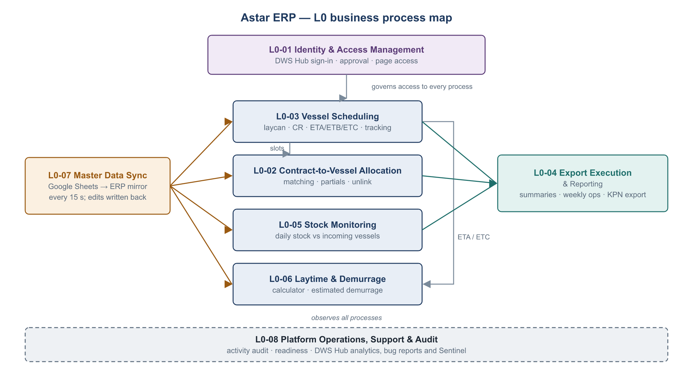

# Astar ERP: Product Requirements Document (PRD)

| | |
|---|---|
| Product | Astar ERP ("AASTAR Logs"): commercial, operations, logistics and chartering portal |
| Version | 1.0, production-readiness baseline |
| Date | 2026-10-29 |
| Status | Draft for business review |
| Product owner | *TBD (business)* |
| Technical owner | *TBD (DWS IT Project)* |
| Related | [CODE-REVIEW.md](CODE-REVIEW.md), [DWS-HUB-INTEGRATION.md](DWS-HUB-INTEGRATION.md) |

> **How this PRD was produced.** It describes the product as it is implemented in the code on 2026-10-29, plus the requirements needed to run it in production for more than 10 concurrent users. Business rules are taken from the code, with file references, so business owners can confirm or correct them. Items marked **[Q]** are open questions for the business (§11).

---

## 1. Product overview

### 1.1 Purpose

The AASTAR / KPN export business runs on several Google Sheets:
- sales and purchase contracts (AASTAR, KIMARA, GR);
- the Vessel DB;
- stock;
- TPG/GLM operations.

Astar ERP gives each team one controlled place to see that data joined together and to make the few edits that need business rules. Those edits are assigning contracts to vessels, maintaining the daily vessel schedule, and unlinking contracts. Google Sheets remain the system of record.

### 1.2 Problems solved

1. **Contract-to-vessel allocation is hard to follow.** Contracts live in five sheets and the vessel schedule in a sixth. The ERP links them with stable IDs (`Match ID`, `VSL ID`) and shows the balances: sales needed, purchase needed, and loaded versus sold.
2. **Daily vessel status is manual reporting.** ETA, ETB and ETC per load call, export summaries, weekly ops slides and demurrage estimates are generated automatically.
3. **Access is uncontrolled.** Raw sheets are all-or-nothing. The ERP grants access per department and per tab, keeps an audit trail and requires approval.

### 1.3 Goals and success metrics

| Goal | Metric | Target |
|---|---|---|
| G1. Single sign-on through DWS Hub | Share of sign-ins through the Hub | ≥ 95 % within 1 month of go-live |
| G2. Reliable data for daily operations | Age of the Sheets mirror (`/api/ready`) | ≤ 60 s for 99 % of business hours |
| G3. Many users at once | Concurrent active users with p95 API latency below 2 s | ≥ 10 required; 50 design target |
| G4. No silent data loss on edits | Duplicate VSL IDs, lost or wrong-row edits | 0 |
| G5. Faster support | Production errors visible in DWS Hub, with a Sentinel analysis | 100 % of new error types analysed within 1 day |

### 1.4 Out of scope (this release)

- Replacing Google Sheets as the system of record.
- Finance features. The Finance landing page is empty, and a cash-flow prototype exists but is not routed **[Q1]**.
- Mobile-native apps. The desktop (Electron) client keeps Google sign-in for now.
- Server-side AIS vessel positions. A client exists but is disabled; the VesselFinder embed is used instead.

---

## 2. Users and roles

| Role | Who | Can do |
|---|---|---|
| **Owner / recovery administrator** | One named person (`MATTHEW_EMAIL`) | Everything an administrator can do, and also: grant or revoke the administrator role, change sign-in emails, delete users, manage IP block and allow lists, send the security activity report |
| **Administrator** | Delegated by the owner | All pages and APIs; approve users; assign page access to non-admin users; manage legacy sheet config; trigger a data refresh; use the admin test tools |
| **Commercial user** | Commercial team | Open Shipments, KPN Export |
| **Operations user** | Operations team | Contract Dashboard, Vessel Contract, TPG/GR Weekly Ops |
| **Logistics user** | Logistics team | Any assigned Logistics tabs (11 tabs), including the edit tools Vessel Update, Vessel Matching and Contract Unlink |
| **Chartering user** | Chartering team | Export Planning |
| **Pending user** | Anyone verified by DWS Hub (or corporate Google) who is not yet approved | Nothing. Sees "awaiting approval". |
| **DWS Hub admin / support** | IT support | Hub analytics, bug reports and Sentinel analyses for Astar ERP (in the Hub, not in the ERP) |

Access is granted per **department** for departments without sub-tabs (Commercial, Chartering, Finance) and per **tab path** for the others (`frontend/src/navConfig.js`). The server enforces the same rules (`backend/middleware/auth.js`).

---

## 3. L0 business process map

| L0 | Process | Business outcome | Primary roles | Modules |
|---|---|---|---|---|
| **L0-01** | Identity and access management | Only approved people see only the data their job needs | Everyone, Admin, Owner | Login, Admin › Users, IP Security |
| **L0-02** | Contract-to-vessel allocation | Every sales and purchase contract is assigned to a vessel load slot; balances are visible | Logistics, Operations, Commercial | Vessel Matching, Contract Unlink, Vessel Contract, Contract Dashboard, Open Shipments |
| **L0-03** | Vessel scheduling and voyage tracking | One up-to-date schedule (laycan, CR, ETA/ETB/ETC) per vessel and port call | Logistics, Chartering | Vessel Update, Vessel Status, Live Vessels, Vessel Map, Export Planning |
| **L0-04** | Export execution and reporting | Monthly and weekly export performance, shipment status and management reports | Logistics, Operations, Commercial | Export Summary (and Total), Weekly Ops, KPN Export, Export Planning |
| **L0-05** | Stock monitoring | Daily stock per port and cargo against incoming vessels | Logistics | Stock Summary |
| **L0-06** | Laytime and demurrage | Expected demurrage cost per vessel and port is known in advance | Logistics, Chartering | Demurrage calculator, Export Summary (Est. Demm) |
| **L0-07** | Master data synchronisation | ERP views reflect the Google Sheets within one sync cycle; edits go back to the sheets | System, Admin | Bulk sync, Admin › Refresh, Data browser |
| **L0-08** | Platform operations, support and audit | The service is secure, observable and supportable | Owner, Admin, IT support | Activity reports, `/api/ready`, DWS Hub SDK and Sentinel |

---

## 4. L1 and L2 detailed business processes

The notation is **L1** (sub-process), then **L2** steps (activities), each with an actor and the system behaviour.

### L0-01 Identity and access management

| L1 | L2 step | Actor | System behaviour / rule |
|---|---|---|---|
| **L1-01.1 Sign in with DWS Hub** | 1. Open the ERP (or launch it from a Hub tile) | User | An unauthenticated route redirects to `/login`, keeping the requested page as `next` |
| | 2. Click **Sign in with DWS Hub** | User | `GET /api/auth/sso/login` creates `state`, `nonce` and a PKCE S256 verifier, sealed in a 10-minute HttpOnly cookie, and redirects to the Hub `/authorize` |
| | 3. Authenticate at the Hub | User / Hub | The Hub validates `client_id` and `redirect_uri` |
| | 4. Callback | System | Checks `state` against the cookie, exchanges the code with the verifier, and verifies the ID token with the JWKS (signature, `iss`, `aud`, `exp`, `sub`, `nonce`) |
| | 5. Map identity | System | Looks up `hub_sub`. Otherwise, links an existing account by email once. Otherwise, creates a **pending** account |
| | 6. Start session | System | Approved users get an 8 h session cookie and land on `next`. Pending users see "awaiting approval" |
| **L1-01.2 Sign in with corporate Google (legacy)** | 1–4 | User | Google Identity Services button; `hd` must be the corporate domain and the email verified. Same approval rules. Will be retired when the Hub is mandatory **[Q2]** |
| **L1-01.3 Approve user and assign access** | 1. Review pending users | Admin | Admin › User Management lists the users with status PENDING |
| | 2. Assign departments and tabs | Admin | At least one page is required before approval. Admin access cannot be granted through a department grant |
| | 3. Approve | Admin | `auth_version` is incremented, which revokes the user's existing sessions |
| | 4. Grant or revoke the administrator role | Owner | The target needs a linked Hub or Google identity and must be approved |
| **L1-01.4 Session lifecycle** | 1. Restore the session on page load | System | `/auth/me` re-checks the user row on every request |
| | 2. Sign out | User | Clears the cookie; the Hub SDK `reset()` is called |
| | 3. Expiry or revocation | System | A 401 clears the client state and redirects to `/login` |
| **L1-01.5 IP security** | 1. Failed sign-ins counted | System | Password and Google failures count toward a block after 4. Hub failures are audit-only |
| | 2. Unlock or allowlist an IP | Owner | Admin › IP Security |

### L0-02 Contract-to-vessel allocation

| L1 | L2 step | Actor | System behaviour / rule |
|---|---|---|---|
| **L1-02.1 Review allocation status** | 1. Open Vessel Contract | Ops / Logistics | One table per vessel → loadport → cargo, with purchase and sales stacks. `balanceToPurchase = purchaseQty − salesQty`; `balanceToLoaded = loadedQty − salesQty` (`services/vesselContract.js`) |
| | 2. Review Pending Matching | Ops / Logistics | Lists contracts without an active VSL link, paged per source sheet |
| | 3. Contract Dashboard | Ops | Per-vessel cards with "Sales needed" and "Purchase needed" lines. Purchase-covered shippers are EUP, SPC, PMC, TPG, GLM and JPN (`services/contractDashboard.js`) |
| | 4. Open Shipments | Commercial | Voyage view. Basis is FOB if any discharge port is "FOB", otherwise CIF. Flags UNALLOCATED (no sales) and TBN |
| **L1-02.2 Assign a contract to a vessel slot** | 1. Choose vessel → loadport slot | Logistics | A slot is valid when the port block has a VSL ID, a port name and `L/D = Load` |
| | 2. Pick a sales or purchase contract | Logistics | Lists AASTAR, KIMARA and GR sales and purchase contracts |
| | 3. Save | System | **The DB10 "Vessel Links" ledger is authoritative.** A link row is appended or updated, and the legacy VSL column on the source sheet is mirrored on a best-effort basis. Optimistic checks on the expected ref, Match ID and assigned VSL |
| **L1-02.3 Split a partial shipment** | 1. **+ Partial** | Logistics | Inserts a child row with a new Match ID, PARTIAL flag and quantity 0 |
| | 2. Set P.Qty | Logistics | Must be a number ≥ 0, and only on PARTIAL rows. Parent quantity = contract quantity − Σ child quantities |
| | 3. **Partial −** | Logistics | Only a child row can be removed |
| **L1-02.4 Unlink a contract** | 1. Search active links | Logistics | Contract Unlink lists the active DB10 links |
| | 2. Confirm unlink | Logistics | Guarded by the expected VSL ID. The contract returns to Pending Matching |

### L0-03 Vessel scheduling and voyage tracking

| L1 | L2 step | Actor | System behaviour / rule |
|---|---|---|---|
| **L1-03.1 Maintain the daily vessel schedule** | 1. Filter vessels (OPEN/ALL, entity, search) | Logistics | Reads DB6 (VESSEL DB) and DB8 (port and cargo lists) |
| | 2. Edit vessel and port fields | Logistics | Edits are staged per cell. Up to 10 port blocks per vessel: L/D, port, shipper, entity, qty, cargo, open/closed, laycan, CR, ETA/ETB/ETC |
| | 3. Save row or Save all | System | Writes run one at a time. Each row's identity is re-checked against the live sheet, and shifted rows are skipped and reported. Dates are written as "D Mon YYYY". The demm rate is stored as a number |
| | 4. Reconcile matching | System | A port block that becomes empty or non-load releases its contract links. Port moves within a row carry their links (`slot_remaps`) |
| **L1-03.2 Create or delete a vessel entry** | 1. Add Vessel Entry | Logistics | Vessel name is required. A new `vsl_YY_NNNN` is generated from the **live** sheet and written after the last row that has a vessel name |
| | 2. Delete row | Logistics | Requires confirmation. Rejected with 409 if the row changed in the sheet |
| **L1-03.3 Publish the daily ETA status** | 1. Vessel Status | Logistics | Load calls sorted Month → Port → ETA. Default shippers are EUP, SPC, PMC, TPG and GLM. The displayed demm rate is the base rate + 2,000 for those shippers when the vessel has no FOB discharge **[Q4]** |
| | 2. Copy the table as an image | Logistics | Copies a PNG to the clipboard, or downloads it |
| **L1-03.4 Track live positions** | 1. Live Vessels / Vessel Map | Logistics | OPEN vessels with an IMO, MMSI or lat/long, shown in a VesselFinder embed |
| **L1-03.5 Plan exports** | 1. Export Planning | Chartering / Logistics | One row per vessel loadport. Status is Pending if ops contains "pending", otherwise Scheduled. Defaults: OPEN vessels, charterer AlphaStar |

### L0-04 Export execution and reporting

| L1 | L2 step | Actor | System behaviour / rule |
|---|---|---|---|
| **L1-04.1 Monthly export breakdown** | 1. Export Summary (previous, current and next month) | Logistics | Counts only load port blocks that have a shipper and qty > 0. The month comes from the laycan start, otherwise the Month column. Sections: EUP-Bontang, EUP-Tanjung Pura, EUP-Other, PMC, SPC, TPG, plus 3P/JPN. EOM stock from DB7 |
| | 2. Adjust the display | Logistics | Client-only: exclude a row's demurrage, or shift a row to the previous or next month (not saved) |
| | 3. Capture or share | Logistics | PNG copy or download per block; full screen |
| **L1-04.2 Export history** | 1. Export Summary Total | Logistics / Management | All months, with Month/Year view and selectors |
| **L1-04.3 Weekly ops meeting** | 1. Open TPG/GR Weekly Ops | Operations | Up to 8 cards: TPG and GLM local deliveries, imports and exports; GR exports Executed, Open and Upcoming |
| | 2. Present | Operations | Full-screen with keyboard navigation, or print |
| | Rules | System | **Executed** = B/L date in the last 30 days and not CANCEL/WASHOUT. **Open** = OPEN/PROV/NOVATED, no B/L, period end ≥ today − 14 d. **Upcoming** = period start in the future. Fully completed rows are hidden |
| **L1-04.4 KPN export schedule** | 1. Configure columns and sort | Commercial | Layout is saved per browser |
| | 2. Export CSV | Commercial | Downloads `kpn-export-YYYY-MM-DD.csv` |

### L0-05 Stock monitoring

| L1 | L2 step | Actor | System behaviour / rule |
|---|---|---|---|
| **L1-05.1 Review daily stock** | 1. Choose a grouping (port / cargo / individual) and filters | Logistics | Reads DB9, the Stock sheet "Monthly" grid |
| | 2. Overlay vessel ETAs | Logistics | ETA (or CR) markers from DB6, matched by port and shipper prefix |
| | Rules | System | PFAD and POMEFAD are combined for EUP Bontang and EUP Tanjung Pura. The page refreshes every 7 s as a fallback |

### L0-06 Laytime and demurrage

| L1 | L2 step | Actor | System behaviour / rule |
|---|---|---|---|
| **L1-06.1 Estimate demurrage (calculator)** | 1. Pick a vessel and port | Logistics | Pre-fills total cargo, laytime rate, demm rate, laytime basis, laycan and ETA/ETB/ETC |
| | 2. Edit inputs and calculate | Logistics | `allowedDays = (qty / laytimeRate) / 24`; `actualDays = ETC − laytimeStart`; `demm = max(0, actual − allowed) × rate` |
| | 3. Capture the result | Logistics | PNG |
| **L1-06.2 Report demurrage (Export Summary)** | Automatic | System | Same formula per row. Laytime start by basis: "Laycan NOR+6", "Laycan All Fast", "NOR" (ETA + 6 h, or the laycan start if ETA ≤ laycan), "All Fast" (ETB). **The calculator and the report differ on the NOR rule [Q3]** |

### L0-07 Master data synchronisation

| L1 | L2 step | Actor | System behaviour / rule |
|---|---|---|---|
| **L1-07.1 Scheduled pull** | Every 15 s | System | One `batchGet` per spreadsheet and service account. Each DB file is rebuilt only when its content hash changes. A run is skipped while another is in progress |
| **L1-07.2 Data hygiene** | During the pull | System | Duplicate Match IDs are repaired (the later copy gets a new ID). Merged child rows are filled down. Identifiers are normalised |
| **L1-07.3 Link graph rebuild** | When DB1–DB6 or DB10 change | System | `vessel_links.db` is rebuilt. Skipped if any source is unavailable |
| **L1-07.4 Change notification** | After a change | System | A websocket `data.updated` is sent to users who can see the affected pages; pages refetch (debounced 500 ms, 60 s polling fallback) |
| **L1-07.5 Manual refresh** | Admin › Refresh | Admin | Forces a pull |

### L0-08 Platform operations, support and audit

| L1 | L2 step | Actor | System behaviour / rule |
|---|---|---|---|
| **L1-08.1 Security activity reporting** | Twice daily (07:00 and 19:00 Singapore time) or on demand | System / Owner | Emails an HTML summary and an Excel audit workbook for the previous 12 h. Activity is retained 90 days |
| **L1-08.2 Usage analytics and error capture** | Continuous | System | The DWS Hub SDK records page views, time in app, JS errors, breadcrumbs and tracked business actions per identified user |
| **L1-08.3 Bug reporting** | When a user hits a problem | User | 🐞 button, or "Report a bug" on the error screen. The page and breadcrumbs are attached |
| **L1-08.4 AI root-cause analysis** | Per new bug or error type | Sentinel (Hub) | Root cause with file:line evidence, a proposed fix and a patch. Engineers review and apply it |
| **L1-08.5 Health monitoring** | Every minute | Monitoring | `GET /api/ready` returns 200 only when the DB answers and the Sheets mirror is under 5 minutes old |
| **L1-08.6 Deploy and restart** | On release | IT | Graceful shutdown on SIGTERM, then restart. `data-release` reports the build to Sentinel |

---

## 5. Functional requirements and user stories

Each function has positive (✅) and negative (❌) user stories. The acceptance criteria use Given / When / Then. IDs are stable so they can be traced to test cases.

### 5.1 Identity and access (L0-01)

#### F-01 Sign in with DWS Hub

| ID | Type | User story | Acceptance criteria |
|---|---|---|---|
| US-01.1 | ✅ | As an approved employee, I want to sign in with my DWS Hub account, so that I don't need a separate ERP credential. | Given Hub SSO is configured, when I click **Sign in with DWS Hub** and authenticate at the Hub, then I land on the page I originally requested (default `/dashboard`) with an 8 h session. |
| US-01.2 | ✅ | As an employee launching the ERP from the Hub dashboard, I want to arrive signed in. | Given the Hub tile targets `/api/auth/sso/login`, when I click it while signed in to the Hub, then the ERP opens signed in without showing the ERP login page. |
| US-01.3 | ✅ | As an existing ERP user, I want my first Hub sign-in to keep my access. | Given my ERP account has the same email as my Hub account, when I first sign in through the Hub, then my account is linked (`hub_sub`) and my pages are unchanged. |
| US-01.4 | ❌ | As a new Hub user without ERP access, I must not see any data. | When I sign in for the first time, then a pending account is created, no session is issued, and the login page says my access awaits approval. |
| US-01.5 | ❌ | As the business, I want an attacker who replays or forges a callback to fail. | Given a callback with a tampered `state`, a missing transaction cookie, or an already-used code, then no session is issued and the user sees "Please sign in again" or "could not be verified". |
| US-01.6 | ❌ | As the business, I want tokens for other apps or from other issuers rejected. | Given an ID token with the wrong `aud`, `iss`, signature, nonce, or expired `exp`, then sign-in fails with `token_invalid`. |
| US-01.7 | ❌ | As a user whose email domain is not allowed, I am refused. | Given `DWS_HUB_ALLOWED_EMAIL_DOMAINS` excludes my domain, then no account is created and I see "not allowed to use Astar ERP". |
| US-01.8 | ❌ | As a user, I see a clear message when the Hub is down. | Given the Hub is unreachable, when I click the button, then I return to the login page with "DWS Hub is not reachable right now" within 10 s. |
| US-01.9 | ❌ | As an administrator, I want account takeover by email reuse prevented. | Given an ERP account is already linked to Hub `sub` A, when Hub `sub` B with the same email signs in, then access is refused with "needs administrator review". |
| US-01.10 | ❌ | As the business, I don't want users redirected to outside sites after login. | Given `next` is an absolute URL, `//host`, `/api/...` or `/login`, then the user is sent to `/dashboard` instead. |

#### F-02 Corporate Google sign-in (legacy, until retired [Q2])

| ID | Type | User story | Acceptance criteria |
|---|---|---|---|
| US-02.1 | ✅ | As an employee on the desktop client, I can still sign in with corporate Google. | Given a verified `@kpn-corp.com` Google identity, then the same approval rules as F-01 apply. |
| US-02.2 | ❌ | Personal Google accounts are refused. | Given a non-corporate or unverified Google account, then sign-in is refused; outside TW/ID the decoy page is shown. |

#### F-03 Approve users and manage access

| ID | Type | User story | Acceptance criteria |
|---|---|---|---|
| US-03.1 | ✅ | As an administrator, I want to approve a pending user with specific tabs, so they see only what they need. | When I tick Approved and select tabs, then the user can open exactly those tabs, and their existing sessions are refreshed. |
| US-03.2 | ✅ | As the owner, I want to make a Hub-linked user an administrator. | Given the user is approved and linked to DWS Hub or Google, then I can tick Administrator. |
| US-03.3 | ❌ | Approval without pages is refused. | When I approve with no pages selected, then I see "Assign at least one page before approving this user". |
| US-03.4 | ❌ | A delegated administrator cannot escalate. | Given I am not the owner, when I edit an administrator, grant admin, or change a sign-in email, then I get 403. |
| US-03.5 | ❌ | Admin access cannot be smuggled in through a department grant. | When `admin` is sent in permissions for a non-admin, then I get 400 "Use the administrator role…". |
| US-03.6 | ❌ | The owner cannot lock themself out. | Removing my own admin role or approval, or deleting my own account, returns 400. |
| US-03.7 | ❌ | Linked sign-in emails are immutable. | Changing the email of a Hub- or Google-linked account returns 400. |

#### F-04 Session lifecycle and sign-out

| ID | Type | User story | Acceptance criteria |
|---|---|---|---|
| US-04.1 | ✅ | As a user, I want to sign out on a shared PC. | When I click Sign out, then the cookie is cleared, the Hub SDK identity is reset, and protected pages redirect to login. |
| US-04.2 | ❌ | Revoked users lose access immediately. | Given an admin changed my access, then my next API call is re-validated: I get 401 if the session was revoked, or 403 `ACCOUNT_PENDING` if I was un-approved. |
| US-04.3 | ❌ | Cross-site write requests are refused. | Given a cookie-authenticated POST without a matching `X-ERP-CSRF` header, then the response is 403 `CSRF_INVALID`. |

#### F-05 IP security (owner)

| ID | Type | User story | Acceptance criteria |
|---|---|---|---|
| US-05.1 | ✅ | As the owner, I can unlock a blocked IP or allowlist the office IP. | Changes take effect immediately and are audited. |
| US-05.2 | ❌ | Invalid input is refused. | A non-IP value returns 400; an unknown IP returns 404. |
| US-05.3 | ❌ | Brute force is stopped. | After 4 failed password or Google sign-ins from one IP, that IP cannot use the APIs until unlocked. |

### 5.2 Commercial (L0-02, L0-04)

#### F-06 Open Shipments (voyage view)

| ID | Type | User story | Acceptance criteria |
|---|---|---|---|
| US-06.1 | ✅ | As a commercial user, I want each open voyage with its contracts, timeline and flags. | Vessel cards show laycan, shipment window, CR/ETA/ETB/ETC, FOB/CIF basis, contracts, and UNALLOCATED/TBN flags. Filters: entity, basis, cargo, search, closed, attention-only. |
| US-06.2 | ✅ | As a commercial user, I want to open the vessel on a tracking site. | With an IMO or MMSI, the VesselFinder and MarineTraffic links open; without them, the links are disabled. |
| US-06.3 | ❌ | Missing source data is explained. | Given a mirror DB is unavailable, then the page shows "temporarily unavailable" instead of empty or partial data. |
| US-06.4 | ❌ | No access, no data. | Without the Open Shipments tab, the route redirects to the dashboard and the API returns 403. |

#### F-07 KPN Export schedule

| ID | Type | User story | Acceptance criteria |
|---|---|---|---|
| US-07.1 | ✅ | As a commercial user, I want to choose, order and sort columns and keep my layout. | The layout persists in this browser after reload. |
| US-07.2 | ✅ | As a commercial user, I want a CSV of exactly what I see. | **Export CSV** downloads the visible columns and filtered rows; the action is tracked in the Hub. |
| US-07.3 | ❌ | Load failure is recoverable. | On an API error, a Retry button reloads. |

### 5.3 Operations (L0-02, L0-04)

#### F-08 Contract Dashboard

| ID | Type | User story | Acceptance criteria |
|---|---|---|---|
| US-08.1 | ✅ | As an operations user, I want to see which vessels still need sales or purchase cover. | Each vessel card shows "Sales needed" / "Purchase needed" per the rules in L1-02.1. Filters cover entity, cargo, loadport, discharge, status and pending-only. |
| US-08.2 | ✅ | As an operations user, I want large lists to stay fast. | Vessels load in pages (default 80, max 200), with "Load More". Contract details load on expand. |
| US-08.3 | ❌ | A removed vessel's details are handled. | Expanding a vessel that no longer exists shows "Vessel not found" (404) without breaking the page. |

#### F-09 Vessel Contract and Pending Matching

| ID | Type | User story | Acceptance criteria |
|---|---|---|---|
| US-09.1 | ✅ | As ops or logistics, I want vessel → loadport → cargo with purchase and sales quantities and balances. | Balances follow L1-02.1. |
| US-09.2 | ✅ | As ops or logistics, I want the list of contracts still waiting for a vessel. | The Pending Matching panel lists them per source tab, with search and paging. |
| US-09.3 | ❌ | Stale data is not shown as current. | After a contract is matched elsewhere, this page updates within one sync cycle plus 1 s (websocket refresh). |

#### F-10 TPG/GR Weekly Ops Meeting

| ID | Type | User story | Acceptance criteria |
|---|---|---|---|
| US-10.1 | ✅ | As an operations lead, I want the weekly meeting cards generated automatically. | The cards follow the stage rules in L1-04.3. Empty cards are hidden. |
| US-10.2 | ✅ | As a presenter, I want full-screen with keyboard navigation and print. | Arrow keys move between cards; Esc exits; Print prints all cards. |
| US-10.3 | ❌ | When a data source fails, I can retry. | The page shows an error with "Try again". |

### 5.4 Logistics (L0-02, L0-03, L0-04, L0-05, L0-06)

#### F-11 Stock Summary

| ID | Type | User story | Acceptance criteria |
|---|---|---|---|
| US-11.1 | ✅ | As logistics, I want daily stock charts per port or cargo, with incoming vessel ETAs. | Grouping, filters and the ETA overlay work as in L1-05.1. |
| US-11.2 | ❌ | Missing stock data is reported. | Given DB9 is unavailable, the page shows "Stock Summary database DB9 is not available yet" with the last cached data. |

#### F-12 Vessel Status (daily ETA)

| ID | Type | User story | Acceptance criteria |
|---|---|---|---|
| US-12.1 | ✅ | As logistics, I want a daily ETA table I can paste into a report. | **Copy Table** copies a PNG; if the clipboard is denied, the PNG downloads instead. |
| US-12.2 | ✅ | As logistics, I want vessel details with their matched contracts. | Clicking a row opens the detail modal. |
| US-12.3 | ❌ | If the contract overlay fails, the table still shows. | The modal shows the vessel without contracts; the error is logged. |

#### F-13 Live Vessels / Vessel Map

| ID | Type | User story | Acceptance criteria |
|---|---|---|---|
| US-13.1 | ✅ | As logistics, I want the open fleet on a map. | Only OPEN vessels with a valid IMO (7 digits), MMSI (9 digits) or lat/long are listed. The counts show trackable versus missing. |
| US-13.2 | ❌ | Vessels without identifiers are flagged, not silently dropped. | The "missing coordinates" count is shown. |

#### F-14 Export Summary and Export Summary Total

| ID | Type | User story | Acceptance criteria |
|---|---|---|---|
| US-14.1 | ✅ | As logistics, I want the export breakdown for last, this and next month with estimated demurrage and EOM stock. | The sections and rules follow L1-04.1 and L1-06.2. |
| US-14.2 | ✅ | As management, I want the same view across all months. | The Total page offers Month/Year view and selectors. |
| US-14.3 | ❌ | Display adjustments never change source data. | Excluding demurrage or shifting months is client-only and is reset on reload. |
| US-14.4 | ❌ | An empty period is explicit. | "No export records are available for this period." |

#### F-15 Vessel Update (daily edit), the main write path

| ID | Type | User story | Acceptance criteria |
|---|---|---|---|
| US-15.1 | ✅ | As logistics, I want to edit ETA/ETB/ETC, remarks and port fields inline and save them to the Vessel DB. | Edits are staged; **Save row** or **Save all** writes to the sheet and DB6; the toast shows the saved count; other users' pages refresh. |
| US-15.2 | ✅ | As logistics, I want to add a new vessel. | Given a vessel name, a unique `vsl_YY_NNNN` is generated from the live sheet and the row is written after the last vessel row. |
| US-15.3 | ✅ | As logistics, I want to delete a wrong entry. | After confirmation, the row is deleted and DB6 refreshes. |
| US-15.4 | ✅ | When I clear or change a load port, linked contracts follow. | A port block that becomes empty or non-load releases its links. Moving a port within the row moves its links. The toast reports released and moved counts. |
| US-15.5 | ❌ | **Two users creating vessels at the same moment get different IDs and rows.** | Given two concurrent creates, then both succeed with distinct VSL IDs and rows, or the second gets 409 "Another change is being saved… try again". Never a duplicate or an overwrite. |
| US-15.6 | ❌ | My edit never lands on another vessel's row. | Given someone inserted or deleted a row in the sheet after my page loaded, when I save, then the affected cells are **skipped** and reported ("N skipped (row shifted)"), and nothing is written to the wrong row. |
| US-15.7 | ❌ | Deleting a row that moved is refused. | Given the row's VSL ID or vessel name in the live sheet differs from what I saw, then I get 409 "This row changed in the sheet. Refresh and try again." |
| US-15.8 | ❌ | Missing vessel name is caught. | Create without a vessel name shows "Vessel name is required". |
| US-15.9 | ❌ | A sheet write failure is reported honestly. | If Google rejects the write, then I see "Save failed: Vessel update write failed", and DB6 is not changed. |
| US-15.10 | ❌ | A background refresh doesn't wipe my unsaved edits. | Cells I am still editing keep their values when data refreshes. |

#### F-16 Vessel Matching (assign contracts to vessel slots)

| ID | Type | User story | Acceptance criteria |
|---|---|---|---|
| US-16.1 | ✅ | As logistics, I want to assign a sales or purchase contract to a vessel loadport slot. | The DB10 ledger is updated (Active = TRUE) and the legacy VSL column is mirrored. Contract Dashboard and Open Shipments reflect it after refresh. |
| US-16.2 | ✅ | As logistics, I want to split a contract across vessels. | **+ Partial** inserts a child row; P.Qty is editable; the parent quantity is recalculated. |
| US-16.3 | ✅ | As logistics, I want to unmatch a contract. | The link is deactivated and the contract returns to Pending Matching. |
| US-16.4 | ❌ | Concurrent assignment of the same contract is detected. | Given another user changed the assignment after my page loaded, then I get 409 "This contract assignment changed…". |
| US-16.5 | ❌ | A slot that disappeared cannot be used. | 409 "This loadport is no longer available…". |
| US-16.6 | ❌ | Copied rows wait for a unique ID. | 409 or 503 "…waiting for a unique ERP Match ID". |
| US-16.7 | ❌ | Invalid partial operations are refused. | Removing a parent → 400. Negative P.Qty → 400. P.Qty on a non-partial row → 400. |

#### F-17 Contract Unlink

| ID | Type | User story | Acceptance criteria |
|---|---|---|---|
| US-17.1 | ✅ | As logistics, I want to search active links and unlink one with confirmation. | After confirming, I see "X is now pending matching" and the row disappears. |
| US-17.2 | ❌ | Unlinking an already-changed link is refused. | 409 "no longer actively linked" or "was reassigned. Refresh before unlinking." |

#### F-18 Demurrage calculator

| ID | Type | User story | Acceptance criteria |
|---|---|---|---|
| US-18.1 | ✅ | As logistics or chartering, I want to estimate demurrage for a vessel and port, including what-if inputs. | Inputs are pre-filled from DB6 and editable. The result follows L1-06.1. Capture produces a PNG. |
| US-18.2 | ❌ | Incomplete inputs are explained. | A missing ETC, laytime rate or basis shows a validation message instead of USD 0. |
| US-18.3 | ❌ | The calculator and the Export Summary must agree. | **[Q3]** For the NOR basis with ETA ≤ laycan start, both use the same rule (currently they differ). |

#### F-19 Export Planning (Chartering and Logistics)

| ID | Type | User story | Acceptance criteria |
|---|---|---|---|
| US-19.1 | ✅ | As chartering, I want one row per vessel loadport with matched contracts and progress. | Defaults: OPEN vessels, charterer AlphaStar. Reset clears the filters. |
| US-19.2 | ❌ | Vessels without a loadport are still visible. | They are listed as "unassigned" rows. |

### 5.5 Platform (L0-07, L0-08)

#### F-20 Google Sheets synchronisation

| ID | Type | User story | Acceptance criteria |
|---|---|---|---|
| US-20.1 | ✅ | As any user, I want sheet changes to appear without reloading. | A change in the sheet appears in open pages within 15 s (sync) + 0.5 s (debounce). |
| US-20.2 | ❌ | A failing source never replaces good data with empty data. | If any range of a DB fails to fetch, that DB is left unchanged and marked unavailable. `/api/ready` turns 503 after 5 minutes without a successful sync. |

#### F-21 Monitoring, analytics, bug reports and Sentinel (DWS Hub)

| ID | Type | User story | Acceptance criteria |
|---|---|---|---|
| US-21.1 | ✅ | As IT support, I want to see who uses which page and for how long. | Hub › Analytic › Astar ERP shows identified users (by Hub `sub`), page paths and time in app within 1 minute. |
| US-21.2 | ✅ | As a user, I want to report a bug from the page I'm on. | The 🐞 button (and "Report a bug" on the error screen) opens the Hub dialog with the page attached. |
| US-21.3 | ✅ | As an engineer, I want an AI root-cause analysis for each new error type. | Sentinel analyses each new error fingerprint and each bug report, reading the code at the reported `data-release`. |
| US-21.4 | ❌ | One page crash doesn't take down the app. | A render error shows "This page could not be displayed" with Reload and Report a bug; the menu keeps working; the error reaches the Hub. |
| US-21.5 | ❌ | No sensitive data leaves the ERP through analytics. | The SDK never sends query strings, form values or request bodies. Tracked actions carry only counts or flags. |
| US-21.6 | ❌ | Without an SDK key, nothing breaks. | Builds without `VITE_HUB_SDK_KEY` emit no script, and all SDK calls are no-ops. |

#### F-22 Security activity reports (owner)

| ID | Type | User story | Acceptance criteria |
|---|---|---|---|
| US-22.1 | ✅ | As the owner, I receive a sign-in and activity audit twice daily. | An email with an HTML summary and an Excel workbook arrives at 07:00 and 19:00 SGT. |
| US-22.2 | ❌ | Duplicate manual sends are prevented. | A second request while one is sending returns 409. An SMTP failure returns 502 with Retry. |

#### F-23 Administration tools

| ID | Type | User story | Acceptance criteria |
|---|---|---|---|
| US-23.1 | ✅ | As an administrator, I can force a data refresh. | Admin › Refresh Cache triggers a pull and returns its result. |
| US-23.2 | ❌ | A failing refresh doesn't crash the service. | A Google error returns 502 "could not be refreshed"; all other users are unaffected. |
| US-23.3 | ❌ | Retired write paths are closed. | Legacy `/sheets/data/:id` writes, `/append`, `/matching-sales/*` and `/queue/flush` return 410. |

---

## 6. Non-functional requirements

### 6.1 Concurrency and performance

| ID | Requirement | Target | How it is met / verified |
|---|---|---|---|
| NFR-01 | Concurrent active users | **≥ 10 required; 50 design target; 100 ceiling on one instance** | Reads come from local SQLite mirrors, so Google read quota does not grow with users. Verify with `backend/scripts/load-test.js` (§8) before go-live. |
| NFR-02 | API latency for page data | p95 < 2 s, p99 < 5 s at 50 users | Dashboard caches per data version. Remaining work: H5 in CODE-REVIEW (move the sync off the main thread, ETag caching). |
| NFR-03 | Write consistency | 0 duplicate IDs, 0 wrong-row writes | Serialized write queue plus live row checks (`services/sheetMutations.js`). Writes wait at most 10 s, then return 409 `SHEET_BUSY`. |
| NFR-04 | Write throughput | ≥ 20 sheet writes per minute sustained | Each write takes about 1–3 s. The Google per-service-account quota (about 60/min) is the ceiling. Retry/backoff on 429 is backlog. |
| NFR-05 | Data freshness | Mirror ≤ 60 s old during business hours | 15 s sync; `/api/ready` alarms at 5 min. |
| NFR-06 | Front-end load | First page interactive < 3 s on office network | Lazy-loaded routes; largest chunk is recharts (~120 KB gzip). |

### 6.2 Availability and reliability

| ID | Requirement | Target |
|---|---|---|
| NFR-07 | Service availability (business hours) | 99.5 % monthly |
| NFR-08 | Restart without data loss | Graceful SIGTERM: drain HTTP, close sockets, flush the activity log, close the DB (≤ 10 s) |
| NFR-09 | Crash resistance | One failing request never terminates the process. Unhandled rejections are logged with a stack. |
| NFR-10 | Health probes | `GET /api/health` (liveness) and `GET /api/ready` (readiness: DB plus sync age) |
| NFR-11 | Backup | Nightly online backup of `erp.db`, `login_security.db` and `user_activity.db`, retained 30 days, outside the code tree. Mirror DBs are rebuildable. *(backlog)* |
| NFR-12 | Process model | Exactly **one** backend instance (in-memory caches, rate limits and write queue) under PM2 or systemd with auto-restart |

### 6.3 Security and privacy

| ID | Requirement |
|---|---|
| NFR-13 | Authentication through DWS Hub OIDC with PKCE S256. ID tokens are verified with the JWKS (asymmetric only), plus `iss`, `aud`, `exp`, `sub` and nonce. No HS256 or bridge flow. |
| NFR-14 | Authorization is enforced on the server for every API and websocket message, per department and tab. |
| NFR-15 | Sessions: HttpOnly `__Host-` cookie, CSRF header on writes, 8 h default, revoked on any access change. |
| NFR-16 | Transport: HTTPS only. HSTS and CSP set by Nginx (allow the DWS Hub for `script-src` and `connect-src`). API responses send nosniff, frame and referrer headers. |
| NFR-17 | Audit: every sign-in outcome (password, Google, `dws-hub`), session event, page visit and request bucket is retained 90 days. |
| NFR-18 | Privacy: analytics carry the Hub user id and email only; no query strings, form contents or business values. Sentinel pseudonymises emails. |
| NFR-19 | Spreadsheet formula injection prevented for free-text writes *(backlog M1)*. |

### 6.4 Supportability

| ID | Requirement |
|---|---|
| NFR-20 | Every production build reports its release (`data-release`) and keeps function names, so stack traces and Sentinel analyses point at real code. |
| NFR-21 | Source code under git, connected to Sentinel (read-only token). CI runs backend and frontend tests and the production build. *(backlog)* |
| NFR-22 | All environment variables are documented in `.env.example` files. |

---

## 7. Data and integrations

| System | Direction | Purpose | Notes |
|---|---|---|---|
| Google Sheets: AASTAR Sales (DB1–DB4, DB10 Vessel Links) | Read every 15 s; write | Contracts and the authoritative link ledger | Service account `aastar-sales@…` |
| Google Sheets: GR Main Shipment File (DB5) | Read; write (matching) | GR contracts | `grsalesandpurchase@…` |
| Google Sheets: Vessel DB (DB6), EOM (DB7), ABV lists (DB8) | Read; write (Vessel Update) | Vessel schedule, month-end stock, dropdowns | `vessel-vs-contract-2-0@…` |
| Google Sheets: Stock (DB9) | Read | Daily stock grid | `kpn-stock@…` |
| Google Sheets: TPG Operations (DB12–DB17) | Read | TPG/GLM imports, local purchases and sales | `palmshptfile@…` |
| Google Sheets: Shipment Details (DB11) | Read | Synced but not used by any page **[Q5]** | |
| DWS Hub | OIDC sign-in; SDK analytics; Sentinel | Identity, usage, errors, AI support | See DWS-HUB-INTEGRATION.md |
| Google Identity Services | Sign-in (legacy) | Corporate Google | Retire with **[Q2]** |
| SMTP (Gmail) | Outbound | Activity reports | |
| VesselFinder / MarineTraffic | Browser embed and links | Vessel positions | No server integration |

---

## 8. Production readiness and release plan

### 8.1 Done in this release

- DWS Hub SSO (strict OIDC) with full negative-path tests.
- Hub SDK with `identify`, `reset`, tracked business actions, `data-release` and kept names; an error boundary that reports to the Hub.
- Serialized sheet writes with live row-identity checks (fixes duplicate VSL IDs and wrong-row writes); Google write timeouts.
- Retired legacy write routes that silently dropped data.
- Crash resistance, graceful shutdown, a readiness probe, API security headers and SQLite busy timeout.

### 8.2 Go-live gates (must pass in staging)

1. `npm test` in `backend` (93 tests) and the frontend unit tests pass; `npm run build` succeeds.
2. Hub registration complete. The manual SSO checks in DWS-HUB-INTEGRATION §8 pass, including the pending, then approval, then sign-in path.
3. **Load test:** at least 25 virtual users for 10 minutes against the read endpoints, with p95 < 2 s and error rate < 1 %. Plus 5 concurrent Vessel Update creates producing 5 distinct VSL IDs.
4. `/api/ready` wired into monitoring, with an alert after 5 minutes of 503.
5. Nginx CSP updated for the Hub; HTTPS app → HTTPS Hub.
6. DB backups scheduled outside the code tree.

### 8.3 Backlog (prioritised, from CODE-REVIEW)

| Priority | Item | Ref |
|---|---|---|
| P1 | Move sync and dashboard builds to a worker thread; ETag/gzip cached payloads; add jitter to client refetches | H5 |
| P1 | Put the code in git; remove backup copies and production DB copies from the tree; add CI | §3.4 |
| P1 | Write free text as RAW, or neutralise leading `= + - @` | M1 |
| P1 | Retry with backoff on Google 429/5xx; cache auth clients | M4 |
| P2 | Per-cell optimistic concurrency on Vessel Update | H6 |
| P2 | Server-side session revocation (`jti`); websocket re-validation; default "remember" off for Google | M2 |
| P2 | Expiring IP blocks; real client IP through Nginx `real_ip`; retire the decoy and GeoIP gate once Hub-only **[Q2]** | H8 |
| P2 | Stop recording failed-password metadata | M11 |
| P2 | Replace the hard-coded owner with a role or Hub group | M12 |
| P3 | Delete dead routers, pages and services; move Vessel Matching out of `pages/test`; flag-gate test tools | M6, M9 |
| P3 | Table virtualisation; one websocket per tab | M8 |
| P3 | Record the acting user in the DB10 ledger `Updated By` | L1 |

---

## 9. Assumptions

- Production runs on three servers: a **frontend server** (Nginx serving the SPA over HTTPS and proxying `/api` on the same origin), a **backend server** (one Node.js instance), and **ApsaraDB RDS for PostgreSQL 18**. Today's single host with SQLite is migrated as described in TECHNICAL-DESIGN.md §4 and §11.
- DWS Hub is in strict mode: the bridge flow is disabled and every Hub user has a stable `sub`.
- Google Sheets remain the system of record, and sheet structures (column positions in `config/dataSources.js`) stay stable.
- About 50 named users, with up to 50 concurrently active at peak.

## 10. Risks

| Risk | Impact | Mitigation |
|---|---|---|
| Google Sheets quota or outage | Stale data, failed writes | Mirror keeps serving the last good data; `/api/ready` alarms; backoff (backlog) |
| A sheet column is moved by a user | Wrong fields read or written | Column map in one file; row-identity checks; add header validation on sync (backlog) |
| Single backend instance | Restart = short outage | Graceful restart; PM2 auto-restart; readiness probe |
| Hub outage | No new sign-ins (existing sessions keep working) | Keep Google sign-in as a fallback until **[Q2]** |
| Code not under version control | Wrong file deployed; no Sentinel code reading | Adopt git before go-live (P1) |

## 11. Open questions for the business

| # | Question |
|---|---|
| Q1 | Should Finance get the cash-flow view (prototype exists: cash OUT at PMT DATE else B/L; cash IN at PMT REC DATE else DUE DATE else B/L; 6-month run-rate and projection)? |
| Q2 | When does DWS Hub become the **only** sign-in? This retires Google sign-in, the always-failing password form, the GeoIP decoy page and IP lockout as access controls. |
| Q3 | Demurrage NOR basis when ETA ≤ laycan start: the Export Summary uses the laycan start, the calculator uses ETA + 6 h. Which is correct? |
| Q4 | Vessel Status / KPN Export add 2,000 to the demurrage rate for EUP/SPC/PMC/TPG/GLM vessels without FOB discharge. Confirm the rule and whether it should be configurable. |
| Q5 | DB11 (Shipment Details) is synced but unused. Keep or stop? |
| Q6 | Which email domains may request access through the Hub (`DWS_HUB_ALLOWED_EMAIL_DOMAINS`)? |
| Q7 | Who replaces the hard-coded owner (`MATTHEW_EMAIL`) as super-administrator, and should it come from a Hub group? |

## 12. Glossary

| Term | Meaning |
|---|---|
| **VSL ID** | Vessel ID `vsl_YY_NNNN` (column A of the VESSEL DB); each port block also has a slot VSL ID |
| **Match ID** | Stable ERP ID of a contract row, used by the DB10 Vessel Links ledger |
| **DB1…DB17** | Local SQLite mirrors of the Google Sheets ranges (`config/dataSources.js`) |
| **Laycan** | Laydays/cancelling window for the vessel at a load port |
| **CR / ETA / ETB / ETC** | Cargo readiness / estimated time of arrival / berthing / completion |
| **Laytime / Demurrage** | Allowed loading time / charge for exceeding it (USD per day, PDPR) |
| **FOB / CIF** | Free On Board / Cost, Insurance and Freight |
| **EOM** | End-of-month stock |
| **3P, JPN** | Third-party shipper; Japan-destined cargo |
| **Sentinel** | DWS Hub's AI production-support agent |
