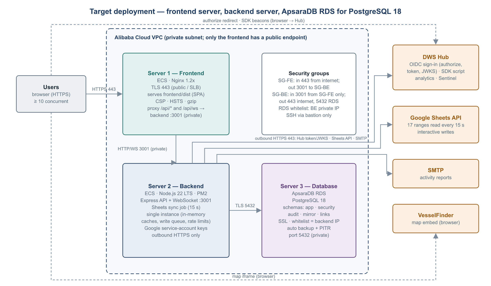
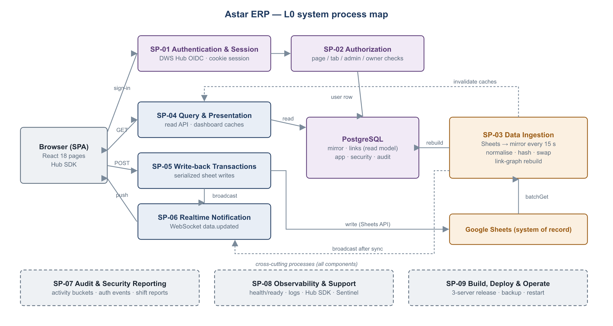
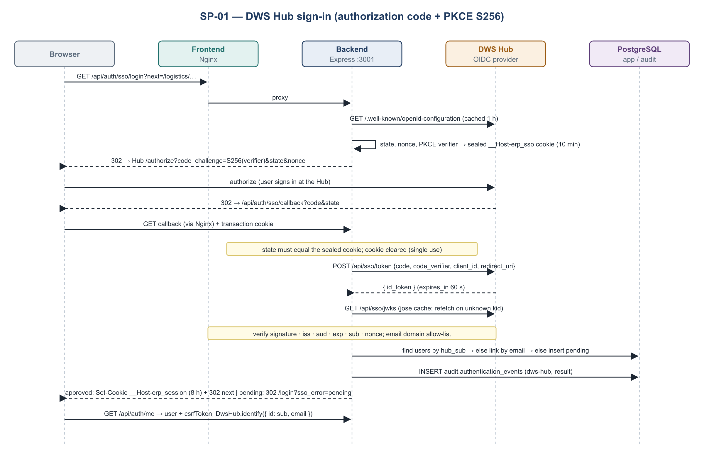
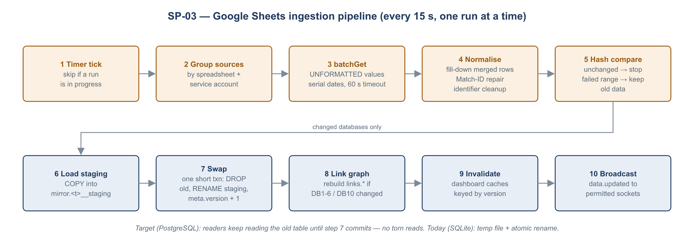
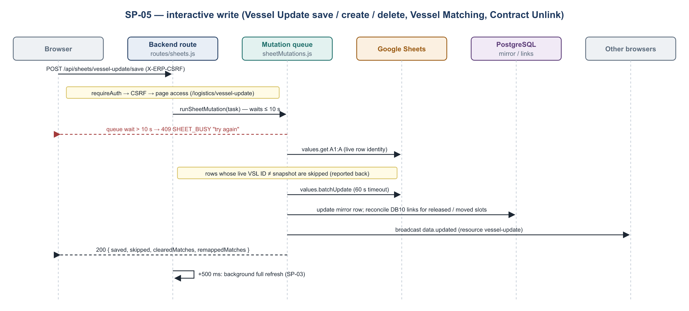
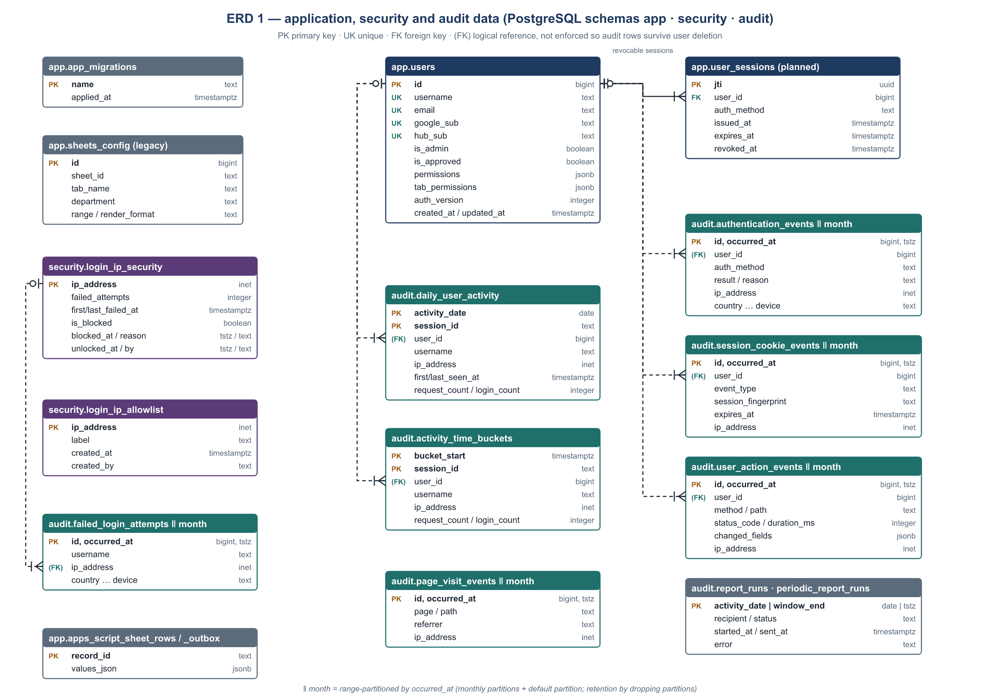
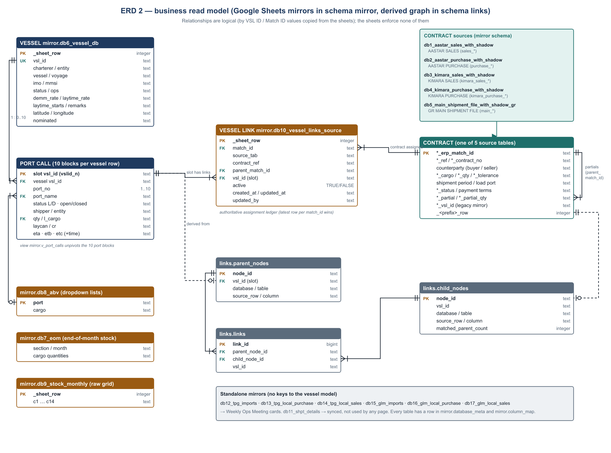

# Astar ERP: Technical Design Document

| | |
|---|---|
| Product | Astar ERP ("AASTAR Logs") |
| Document | Technical design: architecture, system processes (L0–L2), data model (ERD and data dictionary), interfaces, 3-server deployment |
| Version | 1.0 |
| Date | 2026-10-29 |
| Status | Draft for technical review |
| Based on | [PRD.md](PRD.md) v1.0, [CODE-REVIEW.md](CODE-REVIEW.md), [DWS-HUB-INTEGRATION.md](DWS-HUB-INTEGRATION.md), and the source code as of 2026-10-29 |
| Companion artefact | `backend/db/migrations/0001_target_schema.sql`, the target PostgreSQL 18 schema, applied with `npm run db:migrate` (tested on PostgreSQL 18.6) |

---

## 1. Introduction

### 1.1 Purpose

This document describes how Astar ERP is built and how it will run in production. It covers three areas:

1. **What exists today.** A single host runs Node.js, SQLite files and Nginx. All statements about the current system are taken from the code.
2. **The target platform.** There are three servers:
   - a **frontend server** (Nginx serving the React SPA and proxying the API);
   - a **backend server** (Node.js API, WebSocket and Google Sheets sync);
   - **ApsaraDB RDS for PostgreSQL 18** (all persistent data).
3. **The system processes, L0 to L2.** These are the technical counterpart of the business processes in the PRD. Each L2 step names the component and source file that performs it.

### 1.2 Audience

Developers, DevOps / infrastructure, DBAs, security reviewers and IT support (DWS Hub / Sentinel).

### 1.3 Conventions

- **SP-nn** is a system process (L0). **L1-nn.m** is a sub-process. **L2** steps are numbered inside each L1 table.
- "Today" means the code as deployed now (SQLite). "Target" means the 3-server design with PostgreSQL. Where they differ, both are stated.
- File references are relative to the repository root, e.g. `backend/services/hubSso.js`.
- PRD process IDs (L0-01 … L0-08) are business processes. This document's SP-01 … SP-09 are system processes. §5.10 maps one set to the other.

---

## 2. System overview

### 2.1 Context

Astar ERP joins data held in six Google Spreadsheets:
- contracts (AASTAR, KIMARA, GR);
- the Vessel DB;
- stock;
- TPG/GLM operations.

It presents that data as role-specific dashboards, and lets authorised users make a few rule-checked edits that are written back to the sheets. **Google Sheets remain the system of record.** The ERP keeps a mirror (read model) of the sheets, refreshed every 15 s, plus its own application, security and audit data.

### 2.2 Technology stack

| Layer | Technology | Version (lockfile) | Notes |
|---|---|---|---|
| Frontend | React, react-router-dom, Vite (Rolldown) | 18.x, 7.18, 8.2 | Lazy-loaded routes; BrowserRouter (web) or HashRouter (desktop shell) |
| Charts and maps | recharts, react-simple-maps, leaflet / react-leaflet | 3.10, 3.0, 1.9.4 / 4.2.1 | VesselFinder iframe for live positions |
| HTTP client | axios | 1.20 | `withCredentials`, 15 s timeout, CSRF header on writes |
| Backend runtime | Node.js | 22 LTS | single process |
| Web framework | Express | 4.x | helmet, compression, cors, express-rate-limit |
| Realtime | ws | 8.21 | path `/api/ws` |
| Auth | jose (OIDC/JWKS), jsonwebtoken (session), google-auth-library (legacy) | 6.2, 9.x, 9.x | DWS Hub strict OIDC + PKCE |
| Google APIs | googleapis (Sheets v4) | 176 | 5 service accounts |
| Database (today) | better-sqlite3 (SQLite, WAL) | 12.4 | `erp.db`, `login_security.db`, `user_activity.db`, `DB1..DB17.db`, `vessel_links.db` |
| Database (target) | ApsaraDB RDS for PostgreSQL 18, driver `pg` | 18 | schemas `app`, `security`, `audit`, `mirror`, `links` |
| Reports | nodemailer, exceljs, geoip-lite | 9.x, 4.4, 1.4 | shift audit e-mails |
| Observability | DWS Hub SDK + Sentinel, `/api/health`, `/api/ready` | — | see SP-08 |
| Tests | `node:test` | — | 93 backend tests, 22 frontend unit tests |

### 2.3 Logical components

| Component | Location | Responsibility |
|---|---|---|
| SPA shell | `frontend/src/App.jsx`, `components/Sidebar.jsx`, `TopBar.jsx`, `ProtectedRoute.jsx`, `PageErrorBoundary.jsx` | Routing, navigation by permission, page-level error isolation |
| Auth context | `frontend/src/context/AuthContext.jsx`, `services/api.js`, `services/hubSdk.js` | Session restore, CSRF token, sign-out, DWS Hub SDK identify/reset |
| Pages | `frontend/src/pages/**` | 22 business pages (PRD §5) plus admin and test tools |
| Realtime client | `frontend/src/services/realtime.js`, `useDataRefresh.js` | WebSocket subscription, debounced refetch, polling fallback |
| HTTP pipeline | `backend/server.js` | Security headers, CORS, body limit, IP gate, rate limits, routing, error handler, readiness, shutdown |
| Auth and identity | `routes/auth.js`, `services/hubSso.js`, `sessionAuth.js`, `sessionCookie.js`, `googleAccountAccess.js`, `loginSecurity.js`, `loginPresentation.js`, `middleware/auth.js` | SP-01, SP-02 |
| User administration | `routes/users.js` | Approval, access, admin role |
| Read API | `routes/sheets.js` (GET), `routes/vesselSlots.js`, `routes/data.js` | SP-04 |
| Dashboard builders | `services/contractDashboard.js`, `vesselContract.js`, `exportSummary.js`, `vesselStatus.js`, `weeklyOpsMeeting.js`, `stockSummary.js`, `exportPlanning.js`, `liveVessels.js`, `vesselUpdate.js`, `abvOptions.js` | Business rules over the mirror |
| Write API | `routes/sheets.js` (POST), `services/sheetMutations.js`, `vesselMatching.js`, `vesselLinkStore.js`, `contractUnlink.js` | SP-05 |
| Ingestion | `services/bulkDataSync.js`, `config/dataSources.js`, `services/vesselLinks.js` | SP-03 |
| Realtime server | `services/realtime.js` | SP-06 |
| Audit | `services/userActivity.js`, `securityAuditWorkbook.js` | SP-07 |
| Preload | `services/dashboardPreload.js` | Cache warm-up |
| Apps Script bridge (test) | `routes/appsScriptTest.js`, `services/appsScriptSheetSync.js` | Admin proof of concept |

---

## 3. Architecture

### 3.1 Current runtime (single host)

On the current host, Nginx serves the built SPA and proxies `/api` to Express on `127.0.0.1:3001`. The comment at `routes/auth.js` `/gate` shows that Nginx also uses `auth_request` against `/api/auth/gate`. The one Node process runs:
- the HTTP API;
- the WebSocket server;
- the Sheets sync timer (every 15 s);
- the Apps Script outbox (every 2 s);
- the activity flush (every 60 s) and report scheduler;
- the dashboard preload.

All data lives in SQLite files under `backend/data/`.

### 3.2 Target runtime (three servers)



**Design decisions:**

| # | Decision | Rationale |
|---|---|---|
| D1 | **Frontend and API share one origin.** The frontend Nginx proxies `/api/*` and `/api/ws` to the backend's private IP. | Keeps the `__Host-` session cookie, CSRF header model, `SameSite` behaviour and DWS Hub redirect URI unchanged. No CORS is needed for the web app, and the backend gets no public IP. |
| D2 | **Exactly one backend instance.** | Caches, rate-limit counters, the sheet-mutation queue and the sync timer are in-process. A second instance would double Google polling and break write serialisation (CODE-REVIEW §4). Availability comes from PM2 auto-restart plus graceful shutdown. |
| D3 | **All persistent data moves to PostgreSQL.** This includes the Sheets mirror. | Survives backend rebuilds; gives managed backup and point-in-time recovery; lets reporting connect read-only. Mirror swaps are transactional, so readers never see a half-built table. |
| D4 | **The mirror stays text-typed, one table per sheet range.** | Matches the code's current behaviour (all sheet values are strings) and keeps sheet-structure changes from breaking ingestion. Typed access belongs in views, such as `mirror.v_port_calls`. |
| D5 | **Audit tables are partitioned by month.** | Retention (90 days) is done by dropping partitions instead of large DELETEs. |
| D6 | **Secrets stay on the backend server only.** | Google service-account keys, `JWT_SECRET`, DB credentials and SMTP credentials never reach the frontend server. |

### 3.3 Request paths

| Path | Hops |
|---|---|
| Page load | Browser → FE Nginx (static `dist/`, cached assets) |
| API read | Browser → FE Nginx `/api/...` → BE Express → PostgreSQL `mirror` / `links` (or in-process cache) |
| API write | Browser → FE Nginx → BE Express → mutation queue → Google Sheets API → PostgreSQL `mirror` → WebSocket broadcast |
| Realtime | Browser ⇄ FE Nginx `/api/ws` (upgrade) ⇄ BE `ws` |
| Sign-in | Browser → FE → BE `/api/auth/sso/login` → 302 DWS Hub → Browser → FE → BE `/api/auth/sso/callback` → Hub token + JWKS (BE outbound) → PostgreSQL `app.users` |
| Sync | BE timer → Google Sheets API → PostgreSQL `mirror` / `links` |
| Telemetry | Browser → DWS Hub SDK endpoint (direct, not through the ERP) |

---

## 4. Deployment architecture (3 servers)

The staging environment (FE `172.28.92.56:3150`, BE `172.28.92.57:4150`, ApsaraDB database `astar_erp`, DWS Hub
staging) follows this design with Docker containers on shared servers; its runbook is
[DEPLOYMENT-STAGING.md](DEPLOYMENT-STAGING.md). The database roles are named `astar_erp_*` because the RDS
instance is shared with other applications.

### 4.1 Server specification (recommended starting size)

| Server | Service | Size (start) | OS / software | Inbound | Outbound |
|---|---|---|---|---|---|
| **1. Frontend** | Alibaba Cloud ECS (optionally behind SLB/ALB) | 2 vCPU, 4 GB RAM, 40 GB ESSD | Ubuntu 24.04 LTS or Alibaba Cloud Linux 3; Nginx; certbot or SLB certificate | 443 from internet (80 → 301); 22 from bastion | 3001 to backend (private) |
| **2. Backend** | ECS, private subnet, no public IP | 4 vCPU, 8 GB RAM, 60 GB ESSD | Node.js 22 LTS, PM2 | 3001 from frontend security group only; 22 from bastion | 443 to internet (Google APIs, DWS Hub, SMTP, via NAT gateway); 5432 to RDS |
| **3. Database** | ApsaraDB RDS for PostgreSQL **18**, High-availability edition (primary + standby) | 2 vCPU, 8 GB RAM, 100 GB ESSD PL1, storage auto-scale on | — | 5432 from the backend private IP (RDS whitelist) | — |

Sizes assume 50 concurrent users (PRD NFR-01) and should be checked against the staging load test (`backend/scripts/load-test.js`). Before provisioning, **confirm that PostgreSQL 18 is offered in the target region and instance family.** The schema uses no PostgreSQL 18-only features, so PostgreSQL 17 is a drop-in fallback.

### 4.2 Network and security

| Control | Setting |
|---|---|
| VPC | One VPC, two vSwitches: public (frontend / SLB) and private (backend). RDS sits in the private vSwitch zone. |
| SG-FE | In: 443 (and 80) from 0.0.0.0/0; 22 from the bastion SG. Out: 3001 to SG-BE; 443 for OS updates. |
| SG-BE | In: 3001 from SG-FE only; 22 from the bastion SG. Out: 443 (via NAT gateway); 5432 to the RDS endpoint. |
| RDS whitelist | Backend private IP only, plus the bastion for DBA access. No public endpoint. |
| TLS | Public: TLS 1.2+ on Nginx or SLB, HSTS. Database: `sslmode=verify-full` with the RDS CA certificate. |
| DWS Hub | Register redirect URI `https://<erp-host>/api/auth/sso/callback` and Target URL `https://<erp-host>/api/auth/sso/login`. SDK allowed origin: `https://<erp-host>`. |
| Google | Service-account JSON files only on the backend, `chmod 600`, in `SERVICE_ACCOUNTS_DIR`. |

### 4.3 Frontend server: Nginx configuration (reference)

```nginx
upstream erp_backend { server 10.0.2.10:3001; keepalive 32; }   # backend private IP

server {
  listen 443 ssl http2;
  server_name erp.example.com;
  ssl_certificate     /etc/nginx/tls/erp.crt;
  ssl_certificate_key /etc/nginx/tls/erp.key;

  root /var/www/astar-erp/dist;
  index index.html;

  add_header Strict-Transport-Security "max-age=31536000; includeSubDomains" always;
  add_header X-Content-Type-Options nosniff always;
  add_header Referrer-Policy strict-origin-when-cross-origin always;
  add_header Content-Security-Policy "default-src 'self'; script-src 'self' https://dwshub.kpndomain.com https://accounts.google.com; connect-src 'self' wss://erp.example.com https://dwshub.kpndomain.com; frame-src https://www.vesselfinder.com https://accounts.google.com; img-src 'self' data: https:; style-src 'self' 'unsafe-inline' https://accounts.google.com" always;

  gzip on; gzip_types application/json application/javascript text/css image/svg+xml;

  location /assets/ { expires 1y; add_header Cache-Control "public, immutable"; try_files $uri =404; }

  location = /api/ws {
    proxy_pass http://erp_backend;
    proxy_http_version 1.1;
    proxy_set_header Upgrade $http_upgrade;
    proxy_set_header Connection "upgrade";
    proxy_set_header Host $host;
    proxy_set_header X-Forwarded-For $remote_addr;
    proxy_set_header X-Forwarded-Proto https;
    proxy_read_timeout 1h;
  }

  location /api/ {
    proxy_pass http://erp_backend;
    proxy_http_version 1.1;
    proxy_set_header Connection "";
    proxy_set_header Host $host;
    proxy_set_header X-Forwarded-For $remote_addr;   # one trusted hop -> app.set('trust proxy', 1)
    proxy_set_header X-Forwarded-Proto https;
    proxy_read_timeout 90s;                          # Google write timeout is 60 s
    client_max_body_size 200k;
  }

  location / { try_files $uri /index.html; add_header Cache-Control "no-cache"; }
}
```

If an SLB/ALB terminates TLS in front of Nginx, enable `real_ip` from the SLB address range. That keeps `X-Forwarded-For` as one hop to the backend and keeps IP-based rate limits and lockout accurate (CODE-REVIEW H8).

### 4.4 Backend server: process configuration (reference)

```js
// /opt/astar-erp/backend/ecosystem.config.js
module.exports = {
  apps: [{
    name: 'astar-erp-api',
    script: 'server.js',
    cwd: '/opt/astar-erp/backend',
    instances: 1,               // D2: never cluster
    exec_mode: 'fork',
    kill_timeout: 12000,        // graceful shutdown completes within 10 s
    max_memory_restart: '1500M',
    env: { NODE_ENV: 'production' },
  }],
};
```

### 4.5 Environment configuration by server

| Variable | Server | Example / rule |
|---|---|---|
| `VITE_HUB_SDK_KEY`, `VITE_HUB_SDK_URL`, `VITE_GIT_SHA` | build of the frontend | Production Hub key and URL; release = git commit |
| `PORT`, `HOST`, `TRUST_PROXY_HOPS` | backend | `3001`; the backend private IP (default `127.0.0.1`); `1` with Nginx only, `2` if an SLB sits in front without `real_ip` |
| `JWT_SECRET` | backend | ≥ 32 random characters; rotation logs everyone out |
| `FRONTEND_URL`, `CORS_ORIGINS` | backend | `https://erp.example.com` |
| `DATABASE_URL`, `PG_POOL_MAX` | backend | `postgres://astar_erp_app_login:<pw>@<rds-host>:5432/erp?sslmode=verify-full&sslrootcert=/opt/astar-erp/secrets/rds-ca.pem`; pool max 20 |
| `MIGRATION_DATABASE_URL` | backend (deploy only) | Same form, owner account `astar_erp_owner`; used only by `npm run db:migrate` |
| `DWS_HUB_URL`, `DWS_HUB_CLIENT_ID`, `DWS_HUB_REDIRECT_URI`, `DWS_HUB_ALLOWED_EMAIL_DOMAINS` | backend | see DWS-HUB-INTEGRATION §3 |
| `SERVICE_ACCOUNTS_DIR` | backend | `/opt/astar-erp/secrets/service-accounts` |
| `GOOGLE_CLIENT_ID`, `GOOGLE_ALLOWED_DOMAIN` | backend | Legacy Google sign-in; unset to disable |
| `SMTP_URL` or `SMTP_HOST` / `SMTP_USER` / `SMTP_PASS`, `USER_ACTIVITY_REPORT_TO` | backend | Activity reports |
| `MATTHEW_EMAIL` | backend | Owner / recovery admin (to be replaced, PRD Q7) |
| `SESSION_AUDIT_HMAC_KEY`, `PASSWORD_AUDIT_HMAC_KEY` | backend | Audit fingerprints |
| `READY_MAX_SYNC_AGE_MS`, `SHEET_MUTATION_MAX_WAIT_MS` | backend | Defaults 300000 and 10000 |

### 4.6 Code changes required for the target platform

| ID | Change | Files | Effort |
|---|---|---|---|
| C-1 | Bind to `process.env.HOST` (default `127.0.0.1`) instead of the hard-coded loopback, so the frontend server can reach the API; `TRUST_PROXY_HOPS` configurable. **Done (Phase 0).** | `backend/server.js` | XS |
| C-2 | Add a PostgreSQL data-access layer (`pg` Pool, async) and move `app` / `security` / `audit` tables to it | `db/database.js`, `services/sessionAuth.js`, `googleAccountAccess.js`, `hubSso.js`, `loginSecurity.js`, `userActivity.js`, `routes/users.js`, `routes/auth.js`, `appsScriptSheetSync.js` | L |
| C-3 | Write the mirror to `mirror.*` with staging tables and a transactional swap; maintain `mirror.database_meta.version` | `services/bulkDataSync.js` | M |
| C-4 | Replace the SQLite file-signature cache keys with `mirror.database_meta.version` | all dashboard builders (`databaseFileSignature` users), `routes/data.js` | M |
| C-5 | Build `links.*` in PostgreSQL | `services/vesselLinks.js`, `vesselLinkStore.js`, `vesselMatching.js`, `contractUnlink.js` | M |
| C-6 | Use one Postgres-backed `audit.ensure_month_partitions` job, and retention by `DROP TABLE` of old partitions | `services/userActivity.js` | S |
| C-7 | Run SQL migrations at deploy time, replacing the inline `ALTER TABLE` try/catch; numbered files in `backend/db/migrations/`. **Runner done (Phase 0):** `backend/db/postgres/migrate.js`, `npm run db:migrate` / `db:status`; checksums, advisory lock, one transaction per file. | `backend/db/postgres/migrate.js`, `scripts/db-migrate.js` | S |
| C-8 | A data migration script (SQLite → PostgreSQL) for `erp.db`, `login_security.db` and `user_activity.db`. The mirror is rebuilt from Sheets, so it is not migrated. | new `backend/scripts/migrate-sqlite-to-postgres.js` | S |
| C-9 | Readiness probe checks PostgreSQL (`SELECT 1`) and pool saturation | `backend/server.js` | XS |

Sizes: XS < ½ day, S ≈ 1 day, M 2–3 days, L 4–6 days. The total, including testing, is about 3 weeks for one developer. §11 gives the phasing.

### 4.7 Deployment procedure

1. **Database.** Create the RDS instance, database `erp` and the login users. On the backend server run `MIGRATION_DATABASE_URL=… npm run db:migrate` as the owner account; it applies every pending file in `backend/db/migrations/` and is safe to re-run. `npm run db:status` shows what is applied.
2. **Backend.**
   - `git pull` or copy the release.
   - `npm ci --omit=dev`.
   - Place `.env` and the service-account keys.
   - `pm2 start ecosystem.config.js` (or `pm2 reload` for an update; SIGTERM is handled gracefully).
   - Check `curl http://<be-ip>:3001/api/ready` on the private network. It returns 200 once the first sync succeeds.
3. **Frontend.**
   - Build with `VITE_HUB_SDK_KEY` and `VITE_GIT_SHA` set: `npm ci && npm run build`.
   - Upload `dist/` atomically: copy to `releases/<sha>`, then switch the `current` symlink.
   - `nginx -t && systemctl reload nginx`.
4. **Smoke test.**
   - `/api/auth/access-status` shows `hubSso.enabled: true`.
   - Sign in through the Hub.
   - Open one page per department.
   - The Hub SDK screen shows "Receiving data".
5. **Rollback.**
   - Frontend: switch the symlink back.
   - Backend: `pm2 deploy` the previous release.
   - Database: migrations are additive and backward-compatible for one release; use RDS point-in-time restore only for data corruption.

---

## 5. System process model (L0 → L1 → L2)

### 5.1 L0 system process map



| L0 | System process | Trigger | Main components | Supports PRD L0 |
|---|---|---|---|---|
| **SP-01** | Authentication and session management | User sign-in; every API request | `hubSso.js`, `routes/auth.js`, `sessionAuth.js`, `sessionCookie.js` | L0-01 |
| **SP-02** | Authorization and access administration | Every API request and WS message; admin edits | `middleware/auth.js`, `routes/users.js`, `ProtectedRoute.jsx` | L0-01 |
| **SP-03** | Data ingestion (Google Sheets → mirror) | Timer (15 s); manual refresh; after writes | `bulkDataSync.js`, `dataSources.js`, `vesselLinks.js` | L0-07 (feeds L0-02 … L0-06) |
| **SP-04** | Query and presentation | Page load; realtime refresh | `routes/sheets.js` (GET), dashboard builders, React pages | L0-02 … L0-06 |
| **SP-05** | Write-back transactions | User edits | `routes/sheets.js` (POST), `sheetMutations.js`, `vesselMatching.js`, `contractUnlink.js` | L0-02, L0-03 |
| **SP-06** | Realtime notification | Data change | `services/realtime.js`, `useDataRefresh.js` | L0-02 … L0-07 |
| **SP-07** | Audit and security reporting | Every request; schedule (07:00 / 19:00 SGT) | `userActivity.js`, `loginSecurity.js`, `securityAuditWorkbook.js` | L0-08 |
| **SP-08** | Observability and support | Continuous | `/api/health`, `/api/ready`, Hub SDK, `PageErrorBoundary.jsx`, Sentinel | L0-08 |
| **SP-09** | Build, deploy and operate | Release; incident | Vite build, PM2, Nginx, RDS backup | L0-08 |

### 5.2 SP-01 Authentication and session management



**L1-01.1 DWS Hub OIDC sign-in**

| L2 | Step | Component | Behaviour | Errors / edge cases |
|---|---|---|---|---|
| 1 | Start | `GET /api/auth/sso/login?next=` (`routes/auth.js`) | Checks Hub SSO is enabled and the IP is not blocked; rate limit 300 per 15 min per IP | Disabled → `/login?sso_error=sso_disabled`; blocked → login error, or decoy outside TW/ID |
| 2 | Discovery | `hubSso.getDiscovery()` | Fetches `<DWS_HUB_URL>/api/sso/.well-known/openid-configuration`, cached 1 h, 10 s timeout | Unreachable → `hub_unavailable` |
| 3 | Transaction | `hubSso.startTransaction()` | Random `state` (32 B), `nonce` (32 B), PKCE verifier (48 B); S256 challenge. Sealed as HS256 JWT in the `__Host-erp_sso` cookie (HttpOnly, Secure, SameSite=Lax, 10 min). `next` is restricted to same-site ERP paths (`safeNextPath`). | Open-redirect attempts fall back to `/dashboard` |
| 4 | Authorize redirect | `hubSso.authorizationUrl()` | 302 to Hub `/authorize` with `response_type=code`, `client_id`, `redirect_uri`, `scope`, `state`, `nonce`, `code_challenge`, `code_challenge_method=S256` | — |
| 5 | Callback | `GET /api/auth/sso/callback` | Reads and clears the transaction cookie; constant-time `state` comparison | Hub `error=` → `hub_denied`; no cookie or mismatch → `session_expired` |
| 6 | Token exchange | `hubSso.exchangeCode()` | `POST /api/sso/token` JSON `{grant_type, code, redirect_uri, client_id, code_verifier}` | `invalid_grant` or non-200 → `token_invalid` |
| 7 | ID token verification | `hubSso.verifyIdToken()` (jose) | JWKS via `createRemoteJWKSet` (refetch on unknown `kid`, 30 s cooldown). Checks issuer from discovery, `aud = client_id`, asymmetric algorithms only, `exp` (15 s tolerance), `sub` present, `nonce` equal if echoed | Any failure → `token_invalid` |
| 8 | Email policy | `isAllowedHubEmail()` | Optional `DWS_HUB_ALLOWED_EMAIL_DOMAINS` | Refused → `identity_not_allowed` (no account created) |
| 9 | Identity mapping | `provisionHubUser()` | Find by `hub_sub`; else link the existing account by case-insensitive email; else insert a pending user | `hub_sub` mismatch → `review_required` |
| 10 | Approval gate | `routes/auth.js` | `is_approved` must be true | Pending → `/login?sso_error=pending` |
| 11 | Session issue | `startSession()` | JWT HS256 `{id, auth_version, jti, csrf, …}` in the `__Host-erp_session` cookie: 8 h, or 30 days with `DWS_HUB_SESSION_REMEMBER`. Audit events recorded; dashboard preload triggered; 302 to `next` | — |
| 12 | Client bootstrap | `AuthContext.jsx` | `GET /api/auth/me` → user + CSRF token (sessionStorage); WebSocket connect; `DwsHub.identify({ id: hub_sub, email })` | 401 → `/login` |

**L1-01.2 Corporate Google sign-in (legacy)**

| L2 | Step | Component | Behaviour |
|---|---|---|---|
| 1 | Button | `Login.jsx` (Google Identity Services) | Shown when `GOOGLE_CLIENT_ID` is set; hidden in the desktop shell only for Hub SSO |
| 2 | Verify | `POST /api/auth/google` → `OAuth2Client.verifyIdToken` | Audience = `GOOGLE_CLIENT_ID` |
| 3 | Domain policy | `isAllowedGoogleIdentity()` | `email_verified`, `hd` = `GOOGLE_ALLOWED_DOMAIN`, email suffix |
| 4 | Provision and gate | `provisionGoogleUser()` | Same pending / approval rules as Hub |
| 5 | Session | `issueSession()` | JSON `{user, csrfToken}` + cookie; "remember" gives 30 days |

**L1-01.3 Per-request session validation**

| L2 | Step | Component | Behaviour |
|---|---|---|---|
| 1 | Extract | `sessionTokenFromRequest()` | Cookie `__Host-erp_session` (≤ 8 KB), else `Authorization: Bearer` |
| 2 | Verify | `verifySessionToken()` | `jwt.verify` HS256 with `JWT_SECRET`; reloads the user row; `auth_version` must match; `is_approved` must be 1 |
| 3 | CSRF | `csrfValidForRequest()` | Cookie transport + POST/PUT/PATCH/DELETE → header `X-ERP-CSRF` must equal the `csrf` claim (constant-time) |
| 4 | Context | `requireAuth` | Sets `req.user`; records request activity (SP-07) |
| 5 | Reject | `requireAuth` | 401 (cookie cleared) or 403 `ACCOUNT_PENDING` / `CSRF_INVALID`; the client redirects to `/login` |

**L1-01.4 Restore and sign-out**

| L2 | Step | Behaviour |
|---|---|---|
| 1 | Restore | On SPA start: `GET /auth/access-status` (decoy check, sign-in options), then `GET /auth/me` |
| 2 | Sign-out | `DwsHub.reset()`, then `POST /auth/logout` (audit "cleared"); cookie cleared; WebSocket closed |

**L1-01.5 Sign-in protection**

| L2 | Step | Component | Behaviour |
|---|---|---|---|
| 1 | IP gate | `server.js` middleware | A blocked IP gets 403 or the decoy on `/api/*`, except health, access-status, sign-in endpoints and page-visit |
| 2 | Rate limits | express-rate-limit | Per 15 min per IP: password 30, Google 200, DWS Hub 300, page-visit 120, Apps Script events 900, global 15,000. Allow-listed IPs skip the sign-in limits. |
| 3 | Lockout | `loginSecurity.js` | 4 failed password or Google sign-ins → blocked until unlocked. DWS Hub failures are audit-only. |
| 4 | Presentation | `loginPresentation.js` | Real login and errors only for GeoIP TW/ID; others get the decoy page (PRD Q2) |
| 5 | Nginx gate | `GET /api/auth/gate` | 204 or 403 for Nginx `auth_request` before serving documents |

### 5.3 SP-02 Authorization and access administration

**L1-02.1 Page-level authorization**

| L2 | Step | Component | Behaviour |
|---|---|---|---|
| 1 | Resolve the grant | `hasPageAccess(user, path)` | Admin → allow. `permissions` contains the department (path segment 1) → allow. `tab_permissions` contains the exact path → allow. |
| 2 | Enforce on API | `canAccessAnyPage()` in `routes/sheets.js`; `requireAnyPage` | Each endpoint lists the page paths that may read it (§7.1). Failure → 403 "Access denied". |
| 3 | Enforce in UI | `ProtectedRoute`, `AuthContext.hasPermission` / `hasTabAccess`, `Sidebar` | Hidden menu entries; direct URL → `/dashboard` |

**L1-02.2 Administrative roles**

| L2 | Step | Component | Behaviour |
|---|---|---|---|
| 1 | Admin | `requireAdmin` | Members of the built-in **Administrator** role (`is_admin`) → add, edit and delete users (any user, other admins included), roles, sheet config, refresh, data browser, test tools |
| 2 | Recovery owner | `requireMatthew` | Email = `MATTHEW_EMAIL` → IP rules, activity report |
| 3 | Invariants | `services/roles.js` start-up and `routes/users.js` | The recovery account always has the Administrator role and stays approved; nobody can delete it, delete themself or remove their own admin role; the Admin Panel comes only with the Administrator role |

**L1-02.3 Roles** (`/api/roles`, Admin → Roles; `services/roles.js`)

| L2 | Validation / action |
|---|---|
| 1 | Every user has one role; the role's pages are written onto its members (`is_admin`, `permissions`, `tab_permissions`), so page checks, sign-in and realtime read the user row unchanged and a role edit applies on the next request. |
| 2 | Name 1–60 characters, unique (case-insensitive) (409). At least one page (400). Only known pages (`config/pages.js`, kept equal to the sidebar by a test); `admin` is refused (400). |
| 3 | The built-in Administrator role cannot be edited or deleted (403). A role with members cannot be deleted (409). |
| 4 | First start after the upgrade: admins get Administrator; users with identical access share one generated role (e.g. "Logistics (2 pages)"); pending users stay without a role. |

**L1-02.4 Add, approve, modify or delete a user** (`POST`, `PUT /api/users/:id`, `DELETE /api/users/:id`)

| L2 | Validation / action |
|---|---|
| 1 | Add: a valid sign-in email (any domain; DWS Hub or Google links the account on first sign-in), unique name and email (409), role required to approve (400). |
| 2 | Edit: target exists (404); a linked email cannot change (400); the recovery email cannot be given to another user (403). |
| 3 | The recovery account and the admin's own account must stay approved with the Administrator role (400). |
| 4 | UPDATE with `auth_version = auth_version + 1`, which revokes the user's sessions on their next request. |
| 5 | Delete: not oneself (400), not the recovery account (403). |

**L1-02.4 Realtime authorization:** `realtime.js` `canReceive` delivers `data.updated` only to sockets whose user can open at least one page affected by the resource.

### 5.4 SP-03 Data ingestion (Google Sheets → mirror)



**L1-03.1 Scheduled pull**

| L2 | Step | Component | Behaviour | Errors |
|---|---|---|---|---|
| 1 | Tick | `startBulkDataSync()` | Every 15 s (`BULK_SYNC_INTERVAL_MS`); a run is skipped while another runs | — |
| 2 | Group | `refreshBulkDatabases()` | One group per (spreadsheet, service account): 6 groups for 17 databases | — |
| 3 | Fetch | `values.batchGet` | `UNFORMATTED_VALUE`, serial dates, 60 s timeout | A failed group marks its databases unavailable; old data is kept |
| 4 | Normalise | `bulkDataSync.js` | Fill-down for merged child rows (DB1–DB5); identifier normalisation; numeric date formatting | — |
| 5 | Match-ID repair | `bulkDataSync.js` | A duplicate `ERP Match ID` gets a new UUID on the later copy, which is written back to the sheet and its legacy VSL cell cleared. If the write fails, the row is quarantined with a blank ID. | Logged |
| 6 | Change detection | SHA hash of the normalised payload | Unchanged → stop for that database | — |
| 7 | Rebuild | `writeDatabase()` | **Today:** temp SQLite file → `renameSync` (atomic on Linux). **Target:** load `mirror.<t>__staging`, then in one transaction drop the old table, rename staging, and upsert `mirror.database_meta` (`version + 1`) and `mirror.column_map`. | A failure leaves the previous table intact |
| 8 | Link graph | `rebuildVesselLinks()` | If any of DB1–DB6 or DB10 changed: rebuild parent nodes (DB6 slots), child nodes (contract rows), links | Skipped if any link source is unavailable |
| 9 | Notify | `broadcastDataUpdated({resource: 'bulk-databases', databases})` | SP-06 | — |
| 10 | Status | `bulkSyncStatus()` | `lastSuccessAt` feeds `/api/ready` (stale after 5 min → 503) | — |

**L1-03.2 Mirror table layouts** (`config/dataSources.js`)

| Layout | Used by | Shape |
|---|---|---|
| `separate` | DB6–DB8, DB10–DB17 | One table per range; `_sheet_row` + one text column per header |
| `side-by-side` | DB1–DB5 | Contract tab and its Shadow tab combined row by row: `_<prefix>_row`, `<prefix>_<header>`…, `_shadow_row`, `shadow_<header>`… |
| `raw-grid` | DB9 | Unparsed grid (`c1…cN`); the Stock Summary parser finds port headers and date rows |

Header-to-column naming: lower snake_case; duplicates get `_2`, `_3`…; empty headers become `col_<n>`. The mapping is kept in `_columns` today and `mirror.column_map` in the target.

**L1-03.3 Manual and post-write refresh:** `POST /api/sheets/refresh` (admin) runs the pull immediately. Writes schedule a refresh 500 ms after success.

### 5.5 SP-04 Query and presentation

**L1-04.1 API request pipeline** (order in `server.js`)

| L2 | Middleware | Purpose |
|---|---|---|
| 1 | helmet | `X-Frame-Options: SAMEORIGIN`, `nosniff`, referrer policy (CSP and HSTS are set by Nginx) |
| 2 | compression | gzip / brotli JSON |
| 3 | cors | Allow-list `FRONTEND_URL`, `CORS_ORIGINS`, `DESKTOP_CLIENT_ORIGIN` |
| 4 | express.json | 100 KB limit, strict |
| 5 | IP gate | SP-01 L1-01.5 |
| 6 | Rate limits | SP-01 L1-01.5 |
| 7 | Router | `/api/auth`, `/api/users`, `/api/sheets`, `/api/data`, `/api/vessel-slots`, `/api/test/apps-script-sheet` |
| 8 | `requireAuth` + page check | SP-01, SP-02 |
| 9 | Error handler | 403 origin, 413 body, 400 JSON, 500 generic (logged with method, path and stack) |

**L1-04.2 Dashboard build and cache**

| L2 | Step | Behaviour |
|---|---|---|
| 1 | Cache key | **Today:** file signature (size + mtime) of each DB file read. **Target:** `mirror.database_meta.version` of each table read. |
| 2 | Hit | Return the cached JSON object (contract dashboard, vessel contract, export summary, vessel status, vessel update, KPN export, live vessels) |
| 3 | Miss | Read the mirror tables, apply the business rules (PRD §4), store the result under the new key |
| 4 | Paging | Contract Dashboard (`limit` 20–200, `offset`), Pending Matching, Contract Unlink, data browser |
| 5 | Preload | `dashboardPreload.js` at start-up (+8 s) and after each sign-in, at most once per 60 s |

**L1-04.3 Client data lifecycle** (`useDataRefresh.js`)

| L2 | Behaviour |
|---|---|
| 1 | Initial fetch on page mount |
| 2 | Subscribe to `data.updated` for the page's resources |
| 3 | Debounce refetches by 500 ms; defer while the tab is hidden |
| 4 | Polling fallback every 60 s (Stock Summary 7 s) |
| 5 | Keep cells the user is editing (Vessel Update) |

### 5.6 SP-05 Write-back transactions



**L1-05.0 Common write envelope** (all writes)

| L2 | Step | Component | Behaviour |
|---|---|---|---|
| 1 | Authenticate | `requireAuth` | Cookie + CSRF header |
| 2 | Serialize | `serialized()` → `runSheetMutation()` | Single in-process FIFO. Waiting more than 10 s → 409 `SHEET_BUSY`. One failure never blocks the next write. |
| 3 | Authorize | handler | Page check (§7.1) |
| 4 | Live re-check | `readSourceRange()` | Row identity is read from the live sheet inside the queue |
| 5 | Write | `writeSourceCells` / `writeSourceRange` / `appendSourceRows` / `deleteSourceRow` | Google Sheets API, 60 s timeout, `USER_ENTERED` (formula-injection risk, CODE-REVIEW M1) |
| 6 | Mirror update | `updateVesselDatabase`, `vesselLinkStore` | Local mirror updated immediately so the next read is consistent |
| 7 | Notify | `broadcastDataUpdated` | SP-06 |
| 8 | Respond | — | JSON result; 4xx with a user-readable reason; 5xx generic |

**L1-05.1 Vessel Update save** (`POST /api/sheets/vessel-update/save`)

| L2 | Step |
|---|---|
| 1 | Validate `updates[]` (integer `row` ≥ 2, `col` ≥ 0); optional `expected_ids{row: vsl_id}` |
| 2 | Compare against the snapshot (`expected_ids`), then against the live column A. Mismatches go to `skipped[]`. |
| 3 | Convert `YYYY-MM-DD` to `D Mon YYYY`; demurrage rate (col O) to a number |
| 4 | Per row: compute the final port blocks. Slots that become empty or non-load are released; valid `slot_remaps` move links |
| 5 | `batchUpdate` the cells, then update the DB6 mirror, then `reconcileVesselMatchingSlots` (DB10) |
| 6 | Broadcast `vessel-update` (and `vessel-matching` if links changed); refresh 500 ms later |

**L1-05.2 Vessel create:** read A:E live → `nextVslId` = `vsl_<YY>_<max+1>` for the current year → target row = last row with a vessel name + 1 → write the sparse row (vessel fields, 10 × 15 port fields; slot VSL-ID formula columns untouched) → refresh and broadcast.

**L1-05.3 Vessel delete:** snapshot check (`vsl_id`) → live check of A and E for the row → `deleteDimension` → refresh and broadcast. A mismatch → 409.

**L1-05.4 Vessel Matching assign / unmatch** (`services/vesselMatching.js`)

| L2 | Step |
|---|---|
| 1 | Validate the tab and row; the row's `ref` and `match_id` must equal `expectedRef` / `expectedMatchId` (409 "row shifted or was copied") |
| 2 | The Match ID must be unique and present (409 / 503 "waiting for a unique ERP Match ID") |
| 3 | The target slot must exist and be a valid load slot (409 "loadport no longer available") |
| 4 | The current assignment must equal `expectedAssignedVslId` (409 "assignment changed") |
| 5 | Upsert the DB10 ledger row (`Active` TRUE / FALSE, `Updated At`, `Updated By`) → append or update in the sheet + local mirror |
| 6 | Mirror the legacy VSL column on the source tab (best effort; `legacyVslSynced`) |

**L1-05.5 Partials:**
- **add-partial:** insert a child row after the group, with a new Match ID, PARTIAL flag and qty 0. Re-merge the group's cells (GR keeps its merge topology).
- **remove-partial:** child rows only.
- **save-partial-qty:** a number ≥ 0 on PARTIAL rows only. The parent quantity is recalculated as contract qty − Σ children.

**L1-05.6 Contract Unlink:** a link is active when its latest DB10 row is Active and its VSL ID equals the contract's VSL. Unlink calls the matching save with an empty value, guarded by `expectedVslId` (409 when reassigned).

### 5.7 SP-06 Realtime notification

| L1 | L2 steps |
|---|---|
| **L1-06.1 Connect** | 1. Browser opens `wss://<host>/api/ws`. 2. Server `upgrade` handler accepts only this path and allow-listed origins. 3. Session cookie verified as in SP-01 (pending or revoked → close). 4. Socket registered with its user's permissions. |
| **L1-06.2 Broadcast** | 1. `broadcastDataUpdated({department, resource, action, …})`. 2. For each socket, `canReceive(user, message)`. 3. Send JSON. Payloads ≤ 16 KB. |
| **L1-06.3 Liveness** | Heartbeat every 30 s; dead sockets terminated. Graceful shutdown closes all sockets. |
| **L1-06.4 Client** | Reconnect with backoff; debounce and refetch (SP-04 L1-04.3). Edit-presence messages (`edit.start` / `change` / `end`) are implemented on the server but not used by any page. |

### 5.8 SP-07 Audit and security reporting

| L1 | L2 steps |
|---|---|
| **L1-07.1 Request activity** | 1. `recordAuthenticatedRequest` per request: user, IP, GeoIP country / region / city, device, path. 2. Aggregated in memory per (15-min bucket, session) and per (day, session). 3. Writes and admin actions are also recorded as `user_action_events` (method, path, status, duration, changed fields). |
| **L1-07.2 Authentication events** | Every sign-in outcome (`auth_method` password / google / dws-hub; `result` success / failure / pending / blocked / rate-limited / review-required / decoy) and every session-cookie event (issued / validated / rejected / cleared) |
| **L1-07.3 Persistence and retention** | Flush every 60 s and on shutdown; purge after `USER_ACTIVITY_RETENTION_DAYS` (default 90, minimum 7). Target: monthly partitions, dropped by the retention job. |
| **L1-07.4 Shift reports** | Scheduler checks every 60 s; at 07:00 and 19:00 Asia/Singapore it sends the previous 12 h. HTML summary plus `aastar-security-audit-<date>-<shift>.xlsx`. Idempotent per window (`periodic_report_runs`). Manual send by the owner (409 if already running, 502 on SMTP failure). |
| **L1-07.5 IP security administration** | Owner lists blocked IPs, unlocks, adds or removes allow-list entries (validated IPv4 / IPv6) |

### 5.9 SP-08 Observability and support · SP-09 Build, deploy and operate

| L1 | L2 steps |
|---|---|
| **L1-08.1 Health** | `GET /api/health`: liveness, always 200 while the process serves. `GET /api/ready`: 200 only if the DB answers, the last successful sync is ≤ 5 min old, and the process is not shutting down. Reports sync age and pending sheet writes. |
| **L1-08.2 Logging** | stdout / stderr captured by PM2 (`pm2 logs`, rotate with `pm2-logrotate`). Errors include method, path and stack. Sign-in failures log the reason code, never tokens. |
| **L1-08.3 Client telemetry** | Hub SDK script injected at build (`vite.config.js`). Page views (path only), time in app, JS errors and breadcrumbs, bug-report button. `identify` after sign-in, `reset` on sign-out. 8 tracked business actions (counts or flags only). |
| **L1-08.4 Error isolation** | `PageErrorBoundary` keeps the shell usable. `window.reportError` forwards the error to the SDK; "Report a bug" opens the SDK dialog. |
| **L1-08.5 AI support** | Sentinel (in the Hub) analyses each new error fingerprint and bug report, reading the code at `data-release` once the repository is connected |
| **L1-09.1 Build** | Frontend: `npm ci && npm run build` with `VITE_HUB_SDK_KEY` and `VITE_GIT_SHA`; names kept for readable stacks. Backend: `npm ci --omit=dev`. CI runs `npm test` in both packages. |
| **L1-09.2 Release** | DB migration → backend `pm2 reload` → frontend symlink switch (§4.7) |
| **L1-09.3 Start and stop** | Start: migrations check → init → realtime → sync → preload (+8 s). Stop (SIGTERM / SIGINT): stop sync → close WS → drain HTTP → flush audit → close DB → exit 0 (hard exit after 10 s). |
| **L1-09.4 Backup and restore** | RDS automatic full backup daily plus log backup (PITR), 14-day retention minimum. Monthly restore drill to a temporary instance. The mirror needs no backup (rebuilt from Sheets in under 1 minute). Service-account keys and `.env` are held in the secrets vault. |
| **L1-09.5 Monitoring** | Alerts: `/api/ready` ≠ 200 for 5 min; backend CPU > 80 % for 10 min; RDS connections > 80 %; RDS storage > 80 %; audit default partition not empty; certificate expiry < 21 days |

### 5.10 Mapping: business processes (PRD) ↔ system processes

| PRD L0 | SP-01 | SP-02 | SP-03 | SP-04 | SP-05 | SP-06 | SP-07 | SP-08 / 09 |
|---|---|---|---|---|---|---|---|---|
| L0-01 Identity & access | ● | ● | | | | | ● | |
| L0-02 Contract allocation | | ○ | ● | ● | ● | ● | ○ | |
| L0-03 Vessel scheduling | | ○ | ● | ● | ● | ● | ○ | |
| L0-04 Export reporting | | ○ | ● | ● | | ● | | |
| L0-05 Stock monitoring | | ○ | ● | ● | | ● | | |
| L0-06 Laytime & demurrage | | ○ | ● | ● | | | | |
| L0-07 Master data sync | | | ● | | ○ | ● | | ○ |
| L0-08 Platform ops & audit | ○ | ○ | | | | | ● | ● |

● primary · ○ supporting

---

## 6. Data architecture

### 6.1 Data stores: today and target

| Today (SQLite file) | Contents | Target (PostgreSQL schema) | Migration |
|---|---|---|---|
| `data/erp.db` | users, app_migrations, sheets_config, apps_script_*, sheet_cache (legacy) | `app` | Copied by script C-8; `sheet_cache` dropped |
| `data/login_security.db` | login_ip_security, login_ip_allowlist | `security` | Copied |
| `data/user_activity.db` | 9 audit tables | `audit` (partitioned) | Copy the last 90 days; credential-structure columns are not migrated (CODE-REVIEW M11) |
| `data/databases/DB1.db … DB17.db` | Sheets mirror, `_database_meta`, `_columns` | `mirror` | **Not migrated**; rebuilt by the first sync |
| `data/databases/vessel_links.db` | Link graph | `links` | Rebuilt by the first sync |
| Orphaned (`shpt_file.db`, `master_matching.db`, `sheets_mirror.db`) | Unused prototypes | — | Not migrated |

### 6.2 ERD 1: application, security and audit



Relationship notes:
- `app.users 1 — N app.user_sessions` is enforced (`ON DELETE CASCADE`). The table is planned for server-side session revocation.
- `app.users 1 — N audit.*.user_id` is **logical** (no FK), so audit history survives user deletion. `username` and `email` are copied into each event for the same reason.
- `security.login_ip_security.ip_address — audit.failed_login_attempts.ip_address` is logical. Historical failures are imported into the lockout table on first start.

### 6.3 ERD 2: business read model (mirror and links)



| Entity (logical) | Physical table | Key | Notes |
|---|---|---|---|
| VESSEL | `mirror.db6_vessel_db` | `_sheet_row`; business key `vsl_id` (`vsl_YY_NNNN`) | One row per voyage, from VESSEL DB A:FX |
| PORT CALL | Columns of `db6_vessel_db` (10 blocks × 16) → view `mirror.v_port_calls` | Slot `vslid_n` | Block n starts at column 20 + 16 (n − 1). Fields: VSL ID (formula), port, L/D, shipper, entity, qty, cargo, open/closed, laycan, CR, ETA (+time), ETB (+time), ETC (+time) |
| VESSEL LINK | `mirror.db10_vessel_links_source` | `match_id` (latest row wins) | Authoritative assignment ledger (contract → slot), written by Vessel Matching and Unlink |
| CONTRACT | `mirror.db1…db5_*_with_shadow*` | `<prefix>_erp_match_id` | Five source tabs with different column prefixes; parent → partial children via `parent_match_id` in DB10 and the PARTIAL flag |
| Link graph | `links.parent_nodes`, `links.child_nodes`, `links.links` | `node_id`, `link_id` | Derived index of slot ↔ contract-row matches, used by the dashboards |
| Reference | `mirror.db8_abv` (ports, cargoes), `db7_eom`, `db9_stock_monthly` | — | Dropdowns, month-end stock, daily stock |
| Standalone | `mirror.db11…db17` | `_sheet_row` | TPG / GLM operations (Weekly Ops); DB11 unused |

### 6.4 Data dictionary: schema `app`

**app.users**: ERP accounts and their access grants.

| Column | Type | Null | Key | Description |
|---|---|---|---|---|
| id | bigint identity | N | PK | Internal user ID (session JWT `id` claim) |
| username | text | N | UK | Display / reference name. New users get their email. |
| email | text | Y | UK (lower) | Sign-in email; immutable once a Hub or Google identity is linked |
| google_sub | text | Y | UK | Google subject (legacy sign-in) |
| hub_sub | text | Y | UK | DWS Hub OIDC `sub`; canonical identity for Hub sign-in and SDK `identify` |
| role_id | bigint | Y | FK → app.roles | The user's one role (migration 0003); NULL while pending without a role |
| is_admin | boolean | N | | Written from the role: true for the Administrator role (CHECK: an admin must be approved) |
| is_approved | boolean | N | | Access approved; false = pending |
| permissions | jsonb (array) | N | | Written from the role: whole-department grants, e.g. `finance` |
| tab_permissions | jsonb (array) | N | | Written from the role: exact page paths, e.g. `/logistics/vessel-update` |
| auth_version | integer | N | | Incremented on every access change; sessions carrying an older value are rejected |
| created_at, updated_at | timestamptz | N | | Audit timestamps |

**app.roles**: page access per role (Admin → Roles, migration 0003).

| Column | Type | Null | Key | Description |
|---|---|---|---|---|
| id | bigint identity | N | PK | Role ID |
| name | text | N | UK (lower) | 1–60 characters |
| description | text | N | | Optional note shown in Admin → Roles |
| is_admin, is_system | boolean | N | UK (is_system) | True only for the built-in Administrator role (every page + Admin Panel; locked) |
| permissions, tab_permissions | jsonb (array) | N | | The role's pages, copied onto its members |
| created_at, updated_at, updated_by | timestamptz, text | N | | Audit fields |

**app.user_sessions** (planned, CODE-REVIEW M2)

| Column | Type | Null | Key | Description |
|---|---|---|---|---|
| jti | uuid | N | PK | Session ID (JWT `jti`) |
| user_id | bigint | N | FK → users.id (cascade) | Owner |
| auth_method | text | N | | `dws-hub` / `google` |
| issued_at, expires_at | timestamptz | N | | Validity window |
| revoked_at, revoked_by | timestamptz, text | Y | | Logout or admin revocation |

**app.app_migrations**

| Column | Type | Null | Key | Description |
|---|---|---|---|---|
| name | text | N | PK | Migration identifier, e.g. `2026-09-delegated-administrators` |
| applied_at | timestamptz | N | | When it ran |

**app.sheets_config** (legacy; not used by the live sync)

| Column | Type | Null | Key | Description |
|---|---|---|---|---|
| id | bigint identity | N | PK | |
| sheet_id | text | N | | Google spreadsheet ID |
| sheet_name, tab_name | text | N | | Display name, tab |
| department | text | N | | Owning department |
| service_account_index | integer | N | | Index into the legacy key list |
| range | text | Y | | A1 range |
| render_format | text | N | | `unformatted` or `formatted` |

**app.apps_script_sheet_rows / _meta / _events / _outbox** (admin proof of concept)

| Table | Columns | Purpose |
|---|---|---|
| apps_script_sheet_rows | record_id (PK, text), row_number (int), values_json (jsonb), pending_append (bool), source_updated_at, updated_at (tstz) | Local copy of Sheet1 rows with stable IDs |
| apps_script_sheet_meta | key (PK), value, updated_at | Sync cursor and settings |
| apps_script_sheet_events | event_id (PK), event_type, payload_json (jsonb), received_at | Idempotent inbound edit events |
| apps_script_sheet_outbox | id (PK), dedupe_key (UK), operation, record_id, column_number, values_json, attempts, next_attempt_at, last_error, created_at, updated_at | Durable outbound writes with retry |

### 6.5 Data dictionary: schema `security`

**security.login_ip_security**

| Column | Type | Null | Key | Description |
|---|---|---|---|---|
| ip_address | inet | N | PK | Client IP (after the trusted proxy) |
| failed_attempts | integer | N | | Counted failures (password or Google) |
| first_failed_at, last_failed_at | timestamptz | Y | | Window |
| last_username | text | Y | | Last attempted name |
| is_blocked | boolean | N | IX | Blocked from all APIs |
| blocked_at, blocked_reason | timestamptz, text | Y | | e.g. `historical-login-failures` |
| unlocked_at, unlocked_by | timestamptz, text | Y | | Owner unlock |

**security.login_ip_allowlist**

| Column | Type | Null | Key | Description |
|---|---|---|---|---|
| ip_address | inet | N | PK | Trusted IP (skips sign-in rate limits and lockout) |
| label | text | Y | | e.g. "Jakarta office" |
| created_at | timestamptz | N | | |
| created_by | text | N | | Owner username |

### 6.6 Data dictionary: schema `audit`

**Client context columns.** Most audit tables repeat the same client context. They are described once here:

| Column | Type | Description |
|---|---|---|
| ip_address | inet | Client IP |
| country_code, country, region, city | text | geoip-lite lookup of the IP |
| user_agent | text | Raw User-Agent (truncated) |
| device | text | Parsed device / browser summary |

| Table | Key | Specific columns | Partitioned | Written by |
|---|---|---|---|---|
| **daily_user_activity** | (activity_date, session_id) | user_id, username, first_seen_at, last_seen_at, last_path, request_count, login_count | no | L1-07.1 |
| **activity_time_buckets** | (bucket_start [15 min], session_id) | same as daily | no | L1-07.1 |
| **failed_login_attempts** | (id, occurred_at) | activity_date, username | monthly | L1-01.5 |
| **authentication_events** | (id, occurred_at) | activity_date, user_id, username, email, auth_method, result, reason, credential_supplied | monthly | L1-01.x |
| **page_visit_events** | (id, occurred_at) | activity_date, page (`login` / `dummy`), path, referrer | monthly | `/auth/page-visit` |
| **user_action_events** | (id, occurred_at) | completed_at, activity_date, user_id, username, email, session_id, method, path, status_code, duration_ms, changed_fields (jsonb), target_reference | monthly | L1-07.1 |
| **session_cookie_events** | (id, occurred_at) | activity_date, user_id, username, email, event_type, session_fingerprint (HMAC), expires_at, auth_method, transport, cookie_name, secure, http_only, same_site | monthly | L1-01.x |
| **report_runs** | activity_date | recipient, status, started_at, sent_at, error | no | daily report (legacy) |
| **periodic_report_runs** | window_end | window_start, recipient, status, started_at, sent_at, error | no | L1-07.4 |

**Function** `audit.ensure_month_partitions(month date)` creates the five monthly partitions for that month. The backend calls it at start-up and daily for the current and next month. Each partitioned table also has a `_default` partition as a safety net; monitoring alerts when it is not empty.

### 6.7 Data dictionary: schema `mirror`

**mirror.database_meta**: one row per mirrored table.

| Column | Type | Description |
|---|---|---|
| database_name, table_name | text (PK) | e.g. `DB6`, `db6_vessel_db` |
| layout | text | `separate`, `side-by-side`, `raw-grid` |
| source_sheet_id, service_account_email, source_tab, source_range | text | Provenance |
| row_count, column_count | integer | Size of this build |
| source_hash | text | Hash of the normalised payload (change detection) |
| version | bigint | +1 on every rebuild; the cache key for dashboards |
| pulled_at | timestamptz | Build time |

**mirror.column_map**: `(database_name, table_name, ordinal)` PK → `column_name`, `source_label` (original sheet header).

**Mirror table catalogue**

| DB | Target table | Spreadsheet → tab!range | Service account | Layout | Consumed by |
|---|---|---|---|---|---|
| DB1 | `db1_aastar_sales_with_shadow` | AASTAR Sales → `AASTAR SALES!A:AU` + `Shadow!A:C` | aastar-sales@ | side-by-side | Vessel Matching, Vessel Contract, Contract Dashboard, Open Shipments, Export Planning, links |
| DB2 | `db2_aastar_purchase_with_shadow` | AASTAR Sales → `AASTAR PURCHASE!A:AK` + `Shadow!D:F` | aastar-sales@ | side-by-side | same |
| DB3 | `db3_kimara_sales_with_shadow` | AASTAR Sales → `KIMARA SALES!A:AQ` + `Shadow!G:I` | aastar-sales@ | side-by-side | same |
| DB4 | `db4_kimara_purchase_with_shadow` | AASTAR Sales → `KIMARA PURCHASE!A:AK` + `Shadow!J:L` | aastar-sales@ | side-by-side | same |
| DB5 | `db5_main_shipment_file_with_shadow_gr` | GR → `MAIN SHIPMENT FILE!A:BN` + `Shadow GR!A:E` | grsalesandpurchase@ | side-by-side | same + Weekly Ops (GR exports) |
| DB6 | `db6_vessel_db` | Vessel → `VESSEL DB!A:FX` | vessel-vs-contract-2-0@ | separate | All logistics pages, links |
| DB7 | `db7_eom` | Vessel → `EOM!A:R` | vessel-vs-contract-2-0@ | separate | Export Summary (EOM stock) |
| DB8 | `db8_abv` | Vessel → `ABV!A:C` | vessel-vs-contract-2-0@ | separate | Vessel Update dropdowns |
| DB9 | `db9_stock_monthly` | Stock → `Monthly!A:N` | kpn-stock@ | raw-grid | Stock Summary |
| DB10 | `db10_vessel_links_source` | AASTAR Sales → `Vessel Links!A:J` | aastar-sales@ | separate | Assignment ledger |
| DB11 | `db11_shpt_details` | Shipment Details → `Shpt Details!A:BC` | tpgsalesandpurchase@ | separate | none (PRD Q5) |
| DB12 | `db12_tpg_imports` | TPG Operations → `TPG IMPORTS!A:V` | palmshptfile@ | separate | Weekly Ops |
| DB13 | `db13_tpg_local_purchase` | → `TPG LOCAL PURCHASE!A:AM` | palmshptfile@ | separate | Weekly Ops |
| DB14 | `db14_tpg_local_sales` | → `TPG LOCAL SALES!A:AD` | palmshptfile@ | separate | Weekly Ops |
| DB15 | `db15_glm_imports` | → `GLM IMPORTS!A:L` | palmshptfile@ | separate | Weekly Ops |
| DB16 | `db16_glm_local_purchase` | → `GLM LOCAL PURCHASE!A:AM` | palmshptfile@ | separate | Weekly Ops |
| DB17 | `db17_glm_local_sales` | → `GLM LOCAL SALES!A:AD` | palmshptfile@ | separate | Weekly Ops |

**mirror.db6_vessel_db**: vessel-level columns (A–T). Every column is `text` except `_sheet_row` (integer).

| Column | Sheet column | Header | Used for |
|---|---|---|---|
| _sheet_row | — | (row number) | Row identity for writes |
| vsl_id | A | vsl_id | Vessel business key `vsl_YY_NNNN` |
| charterer | B | Charterer | Export Planning filter (default AlphaStar) |
| entity | C | Entity | A\*, A\*JV, GR, JPN, 3P |
| mth | D | Mth | Month fallback for Export Summary |
| vessel | E | Vessel | Name; "last real row" for creates |
| voyage | F | Voyage | |
| contractual_lc | G | Contractual LC | Read as `est_demmurage` by `vesselUpdate.js` |
| imo | H | IMO | VesselFinder lookup (7 digits) |
| mmsi | I | MMSI | VesselFinder lookup (9 digits) |
| status | J | Status | OPEN / CLOSED |
| ops | K | Ops | "pending" → planning status Pending |
| allocation | L | Allocation | |
| latitude, longitude | M, N | latitude, longitude | Map fallback |
| demm_rate | O | Demm Rate | USD per day (PDPR) |
| laytime_rate (`load_rate`) | P | Load Rate | MT per hour |
| laytime_starts | Q | Laytime Starts | NOR +6, All Fast, Laycan NOR+6, Laycan All Fast |
| remarks | R | Remarks | Free text |
| nominated | S | Nominated | TRUE / FALSE |
| vslid_1 … port blocks | T onwards | see PORT CALL | 10 × 16 columns |

**mirror.db1_aastar_sales_with_shadow** (example of a contract table; 52 columns). The DB2–DB5 tables follow the same pattern with prefixes `purchase_`, `kimara_sales_`, `kimara_purchase_` and `main_`.

| Column | Header | Column | Header |
|---|---|---|---|
| _sales_row | (row) | sales_ref | REF |
| sales_shpt_year | SHPT YEAR | sales_lexagle | LEXAGLE |
| sales_ctr | CTR | sales_bp | BP |
| sales_cfm | CFM | sales_performed | PERFORMED |
| sales_washout | WASHOUT | sales_balance | BALANCE |
| sales_status | STATUS | sales_trader | TRADER |
| sales_trade_date | TRADE DATE | sales_cargo | CARGO |
| sales_buyer | BUYER | sales_contract_no | CONTRACT NO |
| sales_broker | BROKER | sales_broker_buyer_ref_no | BROKER/BUYER REF NO |
| sales_brokerage_mt | BROKERAGE/MT | sales_qty | QTY |
| sales_tolerance | TOLERANCE | sales_inco_term | INCO TERM |
| sales_basis | BASIS | sales_prov_price | PROV PRICE |
| sales_final_price | FINAL PRICE | sales_sales_value | SALES VALUE |
| sales_currency | CURRENCY | sales_contract_start | CONTRACT START |
| sales_contract_end | CONTRACT END | sales_due_date | DUE DATE |
| sales_shpt_mth | SHPT MTH | sales_cargo_origin | CARGO ORIGIN |
| sales_intention_load_port | INTENTION LOAD PORT | sales_discharge_port | DISCHARGE PORT |
| sales_discharge_country | DISCHARGE COUNTRY | sales_payment_terms | PAYMENT TERMS |
| sales_remarks_outstanding | REMARKS / OUTSTANDING | sales_intention_vessel | INTENTION VESSEL |
| sales_freight | FREIGHT | sales_fob_sale_price | FOB sale Price |
| sales_spot_fwd | Spot/FWD | sales_mtm_price | MTM PRICE |
| sales_trade_margin | Trade Margin | **sales_vsl_id** | VSL_ID (legacy assignment mirror) |
| sales_partial | Partial | sales_partial_qty | Partial Qty |
| **sales_erp_match_id** | ERP Match ID (contract key) | _shadow_row | (row) |
| shadow_as_id | AS ID | shadow_as_contract | AS Contract |
| shadow_as_parent_child | AS Parent/Child | | |

**mirror.db10_vessel_links_source**: `_sheet_row`, `match_id`, `source_tab` (AASTAR SALES / AASTAR PURCHASE / KIMARA SALES / KIMARA PURCHASE / MAIN SHIPMENT FILE), `contract_ref`, `parent_match_id`, `source_row`, `vsl_id` (slot), `active` (TRUE / FALSE), `created_at`, `updated_at`, `updated_by`.

### 6.8 Data dictionary: schema `links`

| Table | Columns | Description |
|---|---|---|
| graph_meta | database_name (PK), parent_database, child_database_count, parent_node_count, child_node_count, link_count, built_at | Build statistics |
| parent_nodes | node_id (PK), database_name, table_name, source_row, source_column, vsl_id (IX) | One vessel load slot (DB6 `vslid_n`) |
| child_nodes | node_id (PK), database_name, table_name, source_row, source_column, vsl_id (IX), matched_parent_count | One contract row (DB1–DB5) carrying a VSL ID |
| links | link_id (PK), vsl_id (IX), parent_node_id (FK), child_node_id (FK, IX), parent_database / table / row / column, child_database / table / row / column | Slot ↔ contract match |

### 6.9 Database roles and access

| Role | Login user | Privileges |
|---|---|---|
| owner (RDS privileged account) | `astar_erp_owner` | DDL and migrations only; not used by the application |
| `astar_erp_app` | `astar_erp_app_login` (backend) | DML on `app`, `security`, `audit`; full control of `mirror` and `links` (staging and swap) |
| `astar_erp_read` | `erp_read_login` (reporting, support) | SELECT on all schemas |

Recommended role settings: `ALTER ROLE astar_erp_app_login SET statement_timeout = '30s'` and `SET idle_in_transaction_session_timeout = '60s'`. Recommended instance parameters: `log_min_duration_statement = 1000`, `pg_stat_statements` enabled, `timezone = 'UTC'`.

---

## 7. Interface specifications

### 7.1 REST API catalogue (base `/api`)

Auth column: — public · S session · A admin · O owner. Unsafe methods with a cookie session need the `X-ERP-CSRF` header.

| Method | Path | Auth | Page permission (any of) | Purpose |
|---|---|---|---|---|
| GET | /health | — | | Liveness |
| GET | /ready | — | | Readiness (DB, sync age) |
| GET | /auth/access-status | — | | Decoy check; Google and Hub sign-in options |
| GET | /auth/gate | — | | Nginx `auth_request` (204 / 403) |
| POST | /auth/page-visit | — | | Login or decoy page visit audit |
| POST | /auth/login | — | | Disabled password sign-in (always 401; audited) |
| POST | /auth/google | — | | Legacy Google sign-in |
| GET | /auth/sso/login | — | | Start DWS Hub sign-in (302) |
| GET | /auth/sso/callback | — | | Hub callback (302) |
| GET | /auth/me | S | | Current user + CSRF token |
| POST | /auth/logout | S | | Sign out |
| GET | /auth/security/blocked-ips, /auth/security/ip-rules | O | | IP security view |
| POST | /auth/security/allowlist, /allowlist/remove, /unlock | O | | IP security changes |
| POST | /auth/activity-report | O | | Send the activity report now |
| GET | /users | A | | List users |
| PUT | /users/:id | A | | Approve or modify a user (§5.3) |
| DELETE | /users/:id | O | | Delete a user |
| POST | /users | O | | 405 (users come from sign-in) |
| GET | /sheets/contract-dashboard | S | /operations/contract-dashboard | Paged vessel cards; `?details=1&vslId=` |
| GET | /sheets/vessel-contract | S | /operations/vessel-contract, /logistics/vessel-contract, /logistics/vessel-status | Vessel → loadport → contracts |
| GET | /sheets/vessel-contract/pending | S | /operations/vessel-contract, /logistics/vessel-contract | Pending matching (paged) |
| GET | /sheets/open-shipments | S | /commercial/open-shipments | Voyage view |
| GET | /sheets/kpn-export | S | /commercial/kpn-export | KPN export schedule |
| GET | /sheets/weekly-ops-meeting | S | /operations/tpg-gr-weekly-ops | Weekly ops cards |
| GET | /sheets/export-summary | S | /logistics/export-summary | 3-month breakdown |
| GET | /sheets/export-summary-total | S | /logistics/export-summary-total | All months |
| GET | /sheets/export-planning | S | /chartering/export-planning, /logistics/export-planning | Planning rows |
| GET | /sheets/stock-summary | S | /logistics/stock-summary | Stock series + ETA overlay |
| GET | /sheets/vessel-status | S | /logistics/vessel-status | Daily ETA table |
| GET | /sheets/vessel-map | S | /logistics/vessel-map | Map list |
| GET | /sheets/live-vessels | S | /logistics/live-vessels | Trackable open fleet |
| GET | /sheets/vessel-update | S | /logistics/vessel-update, /logistics/demurrage | Editable vessel list + dropdowns |
| POST | /sheets/vessel-update/save | S | /logistics/vessel-update | L1-05.1 |
| POST | /sheets/vessel-update/create | S | /logistics/vessel-update | L1-05.2 |
| POST | /sheets/vessel-update/delete | S | /logistics/vessel-update | L1-05.3 |
| GET | /sheets/vessel-matching | S | /logistics/vessel-matching | Contracts and slots |
| POST | /sheets/vessel-matching/save, /add-partial, /remove-partial, /save-partial-qty | S | /logistics/vessel-matching | L1-05.4, L1-05.5 |
| GET | /sheets/contract-unlink | S | /logistics/contract-unlink | Active links (paged) |
| POST | /sheets/contract-unlink | S | /logistics/contract-unlink | L1-05.6 |
| GET | /vessel-slots | S | vessel matching pages | Valid load slots |
| GET | /sheets/config · POST /sheets/config · DELETE /sheets/config/:id | A | | Legacy sheet config |
| POST | /sheets/refresh | A | | Force sync |
| GET | /sheets/queue/stats, /sheets/data/:department, /sheets/matching-sales | A / S | department / vessel matching | Legacy reads (empty cache) |
| PUT/POST | /sheets/data/:id, /append, /queue/flush, /matching-sales/* | S / A | | **410 Gone** (retired) |
| GET | /data/databases, /data/:db/tables, /data/:db/table/:t | A | | Mirror data browser |
| * | /test/apps-script-sheet/* | A (events: shared secret) | | Apps Script proof of concept |

Standard error body: `{ "error": "<message>", "code"?: "<CODE>" }`. Codes used:
- `ACCOUNT_PENDING`
- `ACCOUNT_REVIEW_REQUIRED`
- `CSRF_INVALID`
- `LOGIN_RATE_LIMITED`
- `LOGIN_ACCESS_DENIED`
- `GOOGLE_IDENTITY_NOT_ALLOWED`
- `SHEET_BUSY`

### 7.2 WebSocket protocol (`/api/ws`)

| Direction | Message | Fields |
|---|---|---|
| server → client | `data.updated` | `department`, `resource` (`bulk-databases`, `vessel-update`, `vessel-matching`, `contract-unlink`…), `action`, optional `databases[]`, `rows[]`, `vslId` |
| client → server | `edit.start` / `edit.change` / `edit.end` | Edit presence (implemented on the server, unused by the UI) |
| server → client | `edit.updated` / `edit.ended` / `edit.snapshot` | Presence fan-out |

Limits: 16 KB per message; origin allow-list; session required; 30 s heartbeat.

### 7.3 External integrations

| System | Protocol | Direction | Credentials | Timeouts / limits |
|---|---|---|---|---|
| DWS Hub OIDC | HTTPS JSON: discovery, `/authorize` (browser), `/token`, `/jwks` | Backend → Hub; Browser → Hub | Public client + PKCE (no secret) | 10 s; discovery cached 1 h; JWKS cached by jose |
| DWS Hub SDK | HTTPS script + beacons | Browser → Hub | Publishable key `dwsk_…` + origin allow-list | — |
| Google Sheets API v4 | HTTPS (googleapis) | Backend → Google | 5 service-account JSON keys | 60 s; quota about 60 writes/min per account |
| Google Identity (legacy) | GIS button + ID token verify | Browser / Backend | `GOOGLE_CLIENT_ID` | — |
| SMTP | SMTPS 465 | Backend → mail | `SMTP_URL` / user + password | — |
| VesselFinder / MarineTraffic | iframe / links | Browser | none | — |

---

## 8. Security architecture

| Area | Control |
|---|---|
| Identity | DWS Hub strict OIDC (code + PKCE S256, JWKS-verified asymmetric ID token, `iss`/`aud`/`exp`/`sub`/`nonce`); local approval gate |
| Session | HttpOnly, Secure `__Host-` cookie; HS256 JWT with `jti`, `csrf`, `auth_version`; 8 h default; revoked on any access change |
| CSRF | Double-submit header `X-ERP-CSRF` on unsafe methods; CORS allow-list |
| Authorization | Server-side page / tab checks on every endpoint and WS broadcast; owner-only operations |
| Transport | TLS 1.2+ public; private HTTP between FE and BE inside the VPC; TLS (`verify-full`) to RDS |
| Network | Backend and RDS have no public endpoints; security groups as in §4.2 |
| Secrets | Backend only; files `chmod 600`; rotate `JWT_SECRET` and service-account keys yearly or on staff change |
| Input | 100 KB body limit; parameterised SQL; identifier sanitisation; open-redirect protection on `next` |
| Abuse | Per-IP rate limits; IP lockout for password and Google sign-ins; write queue bound (10 s) |
| Audit | All sign-in outcomes, session events, requests, actions; 90-day retention; twice-daily report |
| Privacy | Analytics without query strings or form data; Sentinel pseudonymises emails |
| Known gaps (backlog) | Formula injection on free text (M1); server-side revocation (M2); `SameSite=None` (M3); password-structure audit (M11); hard-coded owner (M12) |

---

## 9. Concurrency, performance and capacity

| Aspect | Design | Capacity (single backend) |
|---|---|---|
| Reads | Served from mirror + in-process caches keyed by data version; Google reads independent of user count | 50–100 concurrent users after CODE-REVIEW H5 (sync off the main thread); ≥ 10 today |
| Writes | FIFO mutation queue + live row checks; 10 s wait bound | ~20–40 writes/min (Google quota bound) |
| Sync | One run at a time; unchanged data skipped by hash | 17 ranges per 15 s |
| DB connections (target) | `pg` pool max 20; short transactions; statement timeout 30 s | RDS 2 vCPU / 8 GB comfortably serves this |
| Realtime | One broadcast per change, filtered per user | Hundreds of sockets |
| Front-end | Lazy routes; immutable asset caching | — |

Verification is the staging load test (`backend/scripts/load-test.js`): 25 virtual users for 10 minutes with p95 < 2 s and errors < 1 %, plus 5 concurrent creates producing 5 distinct VSL IDs.

---

## 10. Observability and operations runbook (summary)

| Situation | Signal | Action |
|---|---|---|
| Sheets mirror stale | `/api/ready` 503, `sheetsSyncAgeSeconds` rising; log "Bulk fetch failed" | Check Google API reachability or quota and the service-account key; admin "Refresh" |
| Users cannot sign in | `authentication_events` with `dws-hub` failures; login page `sso_error` | See DWS-HUB-INTEGRATION §7 |
| "Another change is being saved" | 409 `SHEET_BUSY`; `pendingSheetWrites` > 5 | Look for slow Google writes (timeouts); retry |
| Office locked out | Many 403 `LOGIN_ACCESS_DENIED` | Owner unlocks the IP or adds the office IP to the allow-list |
| JS errors after a release | Hub Analytic → errors; Sentinel analysis | Roll back the frontend symlink; apply the reviewed fix |
| DB full or slow | RDS monitoring; `pg_stat_statements` | Check audit partitions and retention; scale storage |

---

## 11. Migration plan: SQLite single host → 3 servers with PostgreSQL

| Phase | Scope | Exit criteria |
|---|---|---|
| **0. Foundations** (week 1) | Code into git + CI; C-1 (HOST); C-7 migration runner; provision the 3 servers and RDS; `npm run db:migrate` | Staging reachable; schema applied. **Code part done 2026-10-30**; provisioning open |
| **1. Data layer** (weeks 1–2) | C-2, C-6: async `pg` repositories for `app` / `security` / `audit`; port tests to a PostgreSQL test container | All backend tests green against PostgreSQL |
| **2. Mirror and links** (weeks 2–3) | C-3, C-4, C-5: staging + swap ingestion; version-keyed caches | Dashboards identical to SQLite output for the same sheet snapshot (compare JSON) |
| **3. Data migration and staging** (week 3) | C-8 script; load test; DWS Hub staging registration | Load test passes; SSO checks pass |
| **4. Cut-over** (1 evening) | Freeze writes (maintenance page) → final SQLite export → import → start backend on PostgreSQL → first sync → smoke test → DNS / SLB switch | `/api/ready` 200; users sign in; first edits written to Sheets |
| **5. Hypercare** (2 weeks) | Monitor; keep the old host read-only for fallback | No P1 incidents; old host decommissioned |

**Rollback during cut-over:** point DNS back to the old host. No sheet data is at risk because Google Sheets remain the system of record.

---

## 12. Testing strategy

| Level | Scope | Tooling |
|---|---|---|
| Unit | Business rules (export summary, weekly ops, demurrage, vessel status, open-shipments basis, live vessels), mutation queue, session cookie, login security | `node:test` (backend 93, frontend 22) |
| Integration | DWS Hub OIDC against a mock Hub with real RS256 keys (15 cases); account approval; user management and roles; page authorisation; websocket security | `node:test` + in-process Express |
| Database (target) | Schema migrations and repositories on `postgres:18` | Docker container in CI |
| Performance | 25–50 virtual users, read endpoints; concurrent creates | `backend/scripts/load-test.js` |
| Security | Dependency audit, header check, SSO negative paths, IP lockout | `npm audit`, tests |
| UAT | PRD user stories (positive and negative) per department | PRD §5 IDs |

---

## Appendix A. Glossary

| Term | Meaning |
|---|---|
| Mirror | Read-only copy of a Google Sheets range inside the ERP database |
| Slot | One port block of a vessel row, identified by its slot VSL ID |
| Match ID | ERP-generated stable key of a contract row |
| PKCE | Proof Key for Code Exchange (RFC 7636); S256 = SHA-256 challenge |
| JWKS | JSON Web Key Set, the Hub's public signing keys |
| PITR | Point-in-time recovery (RDS log backup) |
| SG | Security group (Alibaba Cloud firewall) |

## Appendix B. Reference files

| File | Content |
|---|---|
| `backend/db/migrations/0001_target_schema.sql` | Full target DDL: schemas, tables, indexes, partitions, roles |
| `backend/db/postgres/migrate.js`, `backend/scripts/db-migrate.js` | Migration runner and CLI |
| `.github/workflows/ci.yml` | CI: backend tests with PostgreSQL 18, migrations, frontend tests and build |
| `docs/images/*.svg` / `*.png` | Diagrams in this document (SVG is editable) |
| `backend/.env.example`, `frontend/.env.example` | Configuration templates |
| `backend/scripts/load-test.js` | Concurrency gate |
